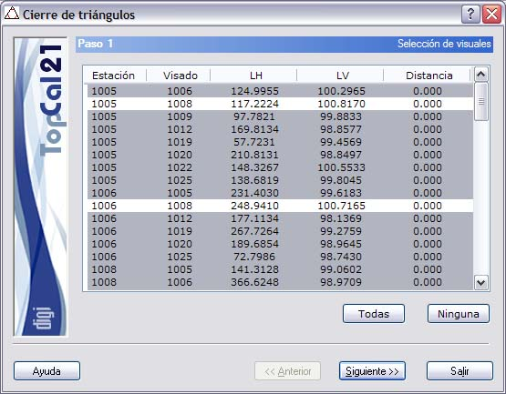

# Step 1: Observation selection
<!-- id: topcal21-cierre-de-triangulos-paso-1-seleccion-de-visuales -->
<!-- origen: 51de906532e51178cbca9b575d067152bf0bc9c2 -->

This is the first step in computing the closure of triangles formed by a set of observations. A dialog box shows the observations contained in the file, in which you must select the observations you want to use in the computation.

The list that is shown contains the following fields:

* **Station point number**
* **Target point number**
* **Horizontal angle**
* **Vertical angle**
* **Distance**

You can select multiple observations by holding the *\[CTRL\]* key and clicking the desired observations with the left mouse button. If you click an observation that is already selected, it is deselected.

You can also select observations arranged in ranges, by pressing the *\[SHIFT\]* key and clicking with the left mouse button the limit observations that define the range.

Likewise, you can use the **All** or **None** buttons to select or deselect all the observations.

After selecting the desired observations, you can go to [Step 2: Repeated and non-reciprocal observations](paso-2-visuales-repetidas-y-sin-reciproca.md) by clicking the **Next** button.
