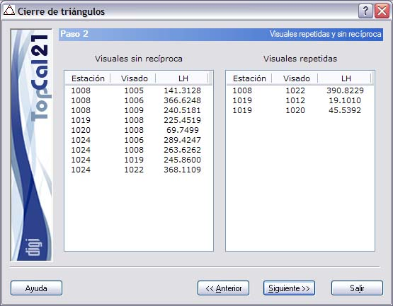

# Step 2: Repeated and non-reciprocal observations
<!-- id: topcal21-cierre-de-triangulos-paso-2-visuales-repetidas-y-sin-reciproca -->
<!-- origen: dace6e9dc7fa634ccd9fddd8398e2d613d33b603 -->

The second step of the closure of triangles shows an informative dialog box with the non-reciprocal and repeated observations found among those selected in the previous step.

If you do not agree with the data shown, you can go back to the previous step, [Step 1: Observation selection](paso-1-seleccion-de-visuales.md), by clicking the **Back** button, or continue with the computation by going to [Step 3: Resulting closures](paso-3-cierres-resultantes.md) by clicking the **Next** button.
