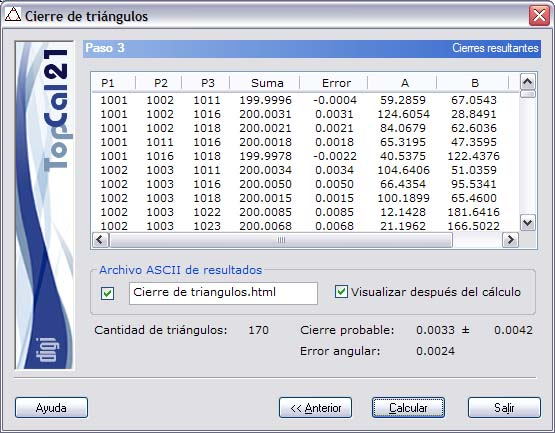

# Step 3: Resulting closures
<!-- id: topcal21-cierre-de-triangulos-paso-3-cierres-resultantes -->
<!-- origen: 14fc7e6803f138b4bb30666d086d1c356f067908 -->

This is the last step in the computation of the closure of triangles. It shows a list of the triangles formed and the resulting closure of each of them.

The list that is shown contains the following fields:

* **Point 1**
* **Point 2**
* **Point 3**
* **Sum of the three angles**
* **Error**, as the difference of the sum minus 200 grads
* **Angle A**, formed by the observations 1-2 and 1-3
* **Angle B**, formed by the observations 2-1 and 2-3
* **Angle C**, formed by the observations 3-1 and 3-2

The program shows the **number of triangles it has been able to close** and their **probable closure**, as the mean of all of them, as well as the **standard deviation** of the series. It also shows the **accidental error** of each triangle so that you can evaluate the quality of the computation.

You can save the results in an output file. This file can be in **html** or **ASCII** format. If the extension of this file is HTM or html, it is treated as html format; otherwise, it is treated as ASCII format. You can view this file (with the viewer set in the [Preferences](../../opciones-de-visualizacion/preferencias.md) dialog box of the [Edit](../../menus-de-la-aplicacion/menu-editar.md) menu) if you select the check box at the bottom named **Show after computation**. If you do not want to create this file, clear the check box to the left of the name. The file is created in the project directory.

After setting up the output data, you can finish the process by clicking the **Compute** button, or go back to the previous step, [Step 2: Repeated and non-reciprocal observations](paso-2-visuales-repetidas-y-sin-reciproca.md), by clicking the **Back** button.
