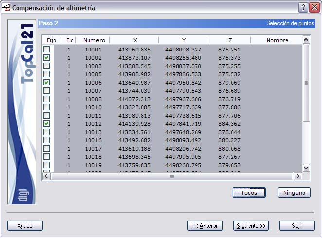

# Step 2: Point selection
<!-- id: topcal21-compensacion-de-altimetria-paso-2-seleccion-de-puntos -->
<!-- origen: c96ce31db136d8d28dc5d15b10d6fcdd7fb2354b -->

This is the second step in computing an altimetry compensation.

A screen is shown with the points with coordinates stored in the point files selected in *Step 1*, and the points that are sighted from these points or that sight these points, whose observations are in the observation files selected in *Step 1*.

The list shown contains the following fields:

* **Fixed checkbox**: This check box indicates whether the point is fixed, depending on whether it is selected or not. To select or clear it, double-click the desired point with the left mouse button.
* **File index**: Indicates the index of the point file where the point is stored. If this field is equal to 0, the point currently has no coordinates and therefore is not stored in any file; instead, there are observations from or to points with known coordinates.
* **Point number**
* **Point coordinates**
* **Point name**

You can select multiple points by holding down the *\[CTRL\]* key and clicking the desired points with the left mouse button. If you click a point that is already selected, it is deselected.

You can also select points arranged in ranges by holding down the *\[SHIFT\]* key and clicking the left mouse button on the boundary points that define the range.

Likewise, you can use the **All** or **None** buttons to select or deselect all the points.

When you have selected the desired points, click the **Next** button to go to [Step 3: Observation selection](paso-3-seleccion-de-visuales.md), or click the **Back** button to return to [Step 1: Enter input data files](paso-1-introducir-ficheros-de-datos-de-entrada.md).
