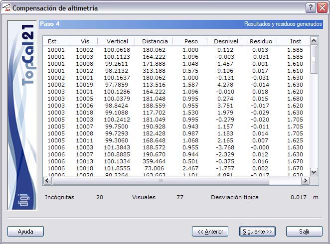

# Step 4: Results and generated residuals
<!-- id: topcal21-compensacion-de-altimetria-paso-4-resultados-y-residuos-generados -->
<!-- origen: cf6a1ec86e787a37a16040f6bf1d7656ee091696 -->

This is the fourth step in computing the altimetry compensation.

A screen is shown with a list of the different observations used in the computation. It also shows the number of unknowns and observations used, as well as the standard deviation of the series.

The fields offered are the following:

* **Station number**
* **Target point number**
* **Vertical angle**
* **Distance**
* **Weight**: The first observation is given a weight of 1, and the following observations are given weights proportional to the ratio between the distances.
* **Height difference**
* **Residual**
* **Instrument height**
* **Reflector height**

Review the residuals of the observations, the **a posteriori standard deviation** of the system and the precision requirements of the job. If you decide to discard an observation, go back to the previous step and deselect that observation.

This step is informational only; you do not need to select anything. You can therefore go on to the next step, [Step 5: Output data setup](paso-5-configurar-salida-de-datos.md), by clicking the **Next** button, or return to the previous step, [Step 3: Observation selection](paso-3-seleccion-de-visuales.md), to make a change by clicking the **Back** button.
