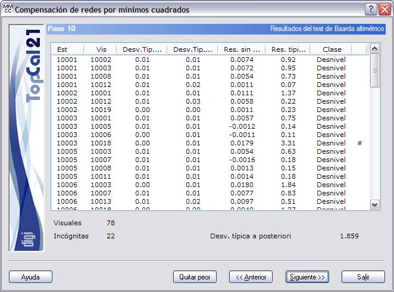

# Step 10: Results of the vertical Baarda test
<!-- id: topcal21-compensacion-por-minimos-cuadrados-paso-10-resultados-del-test-de-baarda-altimetrico -->
<!-- origen: 064a91a805cc46c61fc4daded968758bd38ca6e8 -->

Once the adjustment has been performed and the results presented, the next step is dedicated to the Baarda statistical test. The program shows the standardized residuals of the observations that took part in the computation and the standard deviation of the vertical adjustment.

This test detects possible gross errors in observations by means of a dimensionless value called the standardized residual. If this value exceeds a threshold of 3.29, the observation can be considered erroneous with a probability of 99.9%.

When eliminating erroneous observations, proceed one at a time and always start with the observation that has the largest standardized residual, because one observation can affect the others. You can deselect that observation manually, by going back to *Step 4*, or with the **Remove worst** button, which deselects it in that step.

The result of the statistical test is shown in a list with the following fields:

* **Station**
* **Target point**
* **Standard deviation of the observation**, whose unit is the same as that of the observation
* **Standard deviation of the residual**, whose unit is the same as that of the observation
* **Not weighted residual**, computed with the newly computed coordinates and whose unit is the same as that of the observation.
* **Standardized residual**, whose value must be lower than the threshold of 3.29. If it is higher, the mark # appears on the right. If the goodness of fit of the observation could not be checked, the character “?” appears.
* **Class**: The class is always Height difference.

Clicking the header of this list sorts it in ascending or descending order according to the clicked column.

In addition, the **number of observations** used and the **number of unknowns** that the program has solved are shown.

Finally, the **a posteriori standard deviation** of the system is also shown. Its value is dimensionless and is interpreted as follows:

* If it is lower than 1, the accuracy achieved is greater than the one expected for the instruments used.
* If it is 1, the accuracy achieved is equal to the one expected for these instruments.
* If it is higher than 1, the accuracy achieved is lower than the one expected for those instruments.

This step is informative only; nothing needs to be selected. You can therefore click the **Next** button to go to [Step 11: Output data setup](paso-11-configurar-salida-de-datos.md) or go back to [Step 9: Displacements and vertical accuracies](paso-9-desplazamientos-y-precisiones-altimetricas.md) by clicking the **Back** button.
