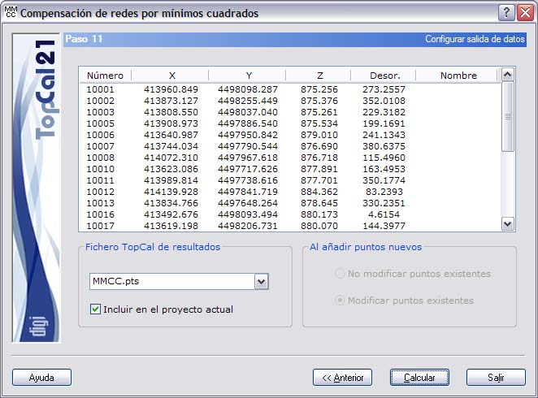

# Step 11: Output data setup
<!-- id: topcal21-compensacion-por-minimos-cuadrados-paso-11-configurar-salida-de-datos -->
<!-- origen: 6dbbab67a580c2d51db2b4e4765d2f1c7f7c9946 -->

In this step a screen is shown with the final computed coordinates and the way to save them. The following fields are shown:

* **Final coordinates**: A list is shown with the new computed points, their coordinates and their orientation.
* **TopCal output file**: You can select the name of the TopCal file where the points are stored. You can choose one of the existing files or generate a new file. If you want to generate a new file, you can choose whether or not to add the file to the current project.
* **Adding new points**: If the point file is not new, you can choose whether or not to modify the points with the same number found in the chosen output file.

Once the output data have been set up, you can click the **Next** button to go to [Step 12: Sketch setup](paso-12-configurar-croquis-de-dibujo.md) or go back to the previous step by clicking the **Back** button. This step depends on the type of adjustment chosen:

* If a vertical adjustment was selected, the previous step is [Step 10: Results of the vertical Baarda test](paso-10-resultados-del-test-de-baarda-altimetrico.md).
* If a vertical adjustment was not selected, the previous step is [Step 7: Results of the horizontal Baarda test](paso-7-resultados-del-test-de-baarda-planimetrico.md).
