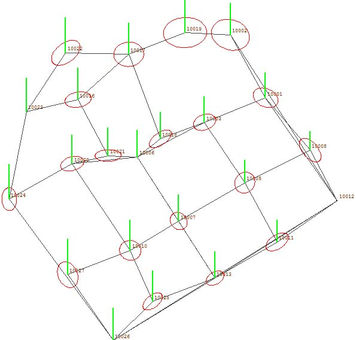
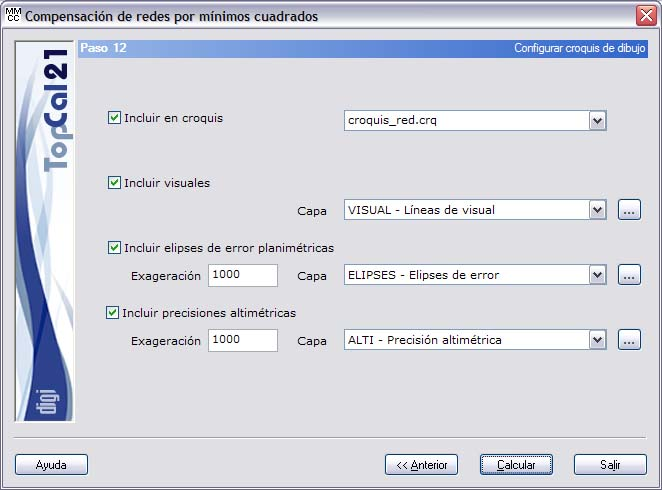

# Step 12: Sketch setup
<!-- id: topcal21-compensacion-por-minimos-cuadrados-paso-12-configurar-croquis-de-dibujo -->
<!-- origen: 763247475e47b699cc018f33e97f6e8160a61d5b -->

This is the last step in the computation of the adjustment of a network and is dedicated to generating a sketch file with the observations used in the computation and the accuracies achieved. The sketch represents the accuracy of each point by means of horizontal error ellipses and vertical accuracy lines, according to the selected options.

The fields shown are the following:

* **Include in the sketch**: Select this checkbox if you want to generate the sketch with the adjusted network. If it is selected, the rest of the fields are enabled, including the one on the right where you must enter the name of the new sketch or choose one of the existing sketches in the project.
* **Include observations**: If you chose to generate the sketch, you can choose to generate lines for each observation that took part in the computation. If this checkbox is selected, the field on the right is enabled to choose the **layer** in which these lines are recorded. If the desired layer is not in the list, you can click the button on the right to create a new layer.
* **Include horizontal error ellipses**: If you chose to generate the sketch and a horizontal adjustment was performed, you can choose to generate ellipses with the horizontal accuracy at each point that took part in the computation. If this checkbox is selected, the field on the right is enabled to choose the **layer** in which these ellipses are recorded. If the desired layer is not in the list, you can click the button on the right to create a new layer. The **exaggeration** field is also enabled; it sets the factor by which the size of the drawn error ellipses is multiplied. This exaggeration can be changed later in the [Sketch properties](../../opciones-de-visualizacion/propiedades-de-los-objetos/propiedades-del-archivo-de-croquis.md).
* **Include vertical accuracies**: If you chose to generate the sketch and a vertical adjustment was performed, you can choose to generate vertical lines with the vertical accuracy at each point that took part in the computation. If this checkbox is selected, the field on the right is enabled to choose the **layer** in which these lines are recorded. If the desired layer is not in the list, you can click the button on the right to create a new layer. The **exaggeration** field is also enabled; it sets the factor by which the length of the drawn vertical accuracy lines is multiplied. This exaggeration can be changed later in the [Sketch properties](../../opciones-de-visualizacion/propiedades-de-los-objetos/propiedades-del-archivo-de-croquis.md).

Once the output data have been set up, you can finish the process by clicking the **Calculate** button or go back to [Step 11: Output data setup](paso-11-configurar-salida-de-datos.md) by clicking the **Back** button.
