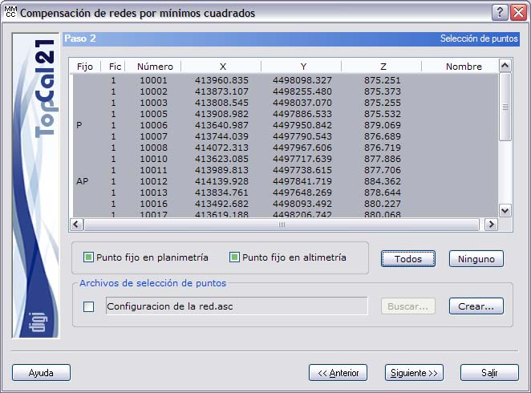

# Step 2: Point selection
<!-- id: topcal21-compensacion-por-minimos-cuadrados-paso-2-seleccion-de-puntos -->
<!-- origen: 9036f85c45a29455fcc98c61892bf6756e134755 -->

This is the second step of the computation. A screen shows the points with coordinates stored in the point files selected in *Step 1*. As mentioned above, the points must have approximate coordinates in order to be adjusted. To compute these coordinates, you should use the other computation tools of the program.

The list contains the following fields:

* **Fixed checkbox**: This checkbox indicates whether the point is fixed or not, both in planimetry and in altimetry. If the point is fixed in planimetry, the letter *P* appears; if it is fixed in altimetry, the letter *A* appears. To assign these characteristics to the points, select the desired points and select or clear the checkboxes located below the list: **Fixed point in planimetry** or **Fixed point in altimetry**.
* **File index**: Indicates the index of the point file where the point is stored.
* **Point number**
* **Point coordinates**
* **Point name**

Multiple points can be selected by holding down the *CTRL* key and clicking the desired points with the left mouse button. If you click a point that is already selected, it is deselected.

Points arranged in ranges can also be selected by holding down the *SHIFT* key and clicking with the left mouse button the limit points that define the range.

In the same way, you can use the **All** or **None** buttons to select or deselect all the points.

It is also possible to load the network information from an ASCII network configuration file by selecting the checkbox located to the left of the file name and clicking the **Search** button to display Windows Explorer.

In addition, if it is the first time the network is configured, you can select the points manually and create the configuration file to be used on later occasions by clicking the **Create** button. The program displays Windows Explorer to save the file; it is recommended to save it in the project folder, together with the rest of the project files.

To perform a vertical compensation, only one fixed point is required, although there may be more.

To perform a horizontal compensation, there are two possibilities:

* There are two or more fixed points, establishing what is called the *base of the network*. In this case, it is possible to determine the scale factor variable in order to detect possible errors in the transmission of the scale factor to the network. To do so, there must be two ways of conveying scale, the possibilities being:
  * More than two fixed points.
  * Two fixed points and distance measurements.
* There is only one fixed point, which is then called a *free network*. In this case, distance measurements are essential to convey scale to the network and, in addition, you must indicate a direction that is kept fixed in the adjustment. You indicate this direction to the program after *Step 5*.

Once the desired points have been selected, you can click the **Next** button to go to [Step 3: Network and output lists setup](paso-3-configuracion-de-la-red-y-listados-de-salida.md) or go back to [Step 1: Enter input data files](paso-1-introducir-ficheros-de-datos-de-entrada.md) by clicking the **Back** button.
