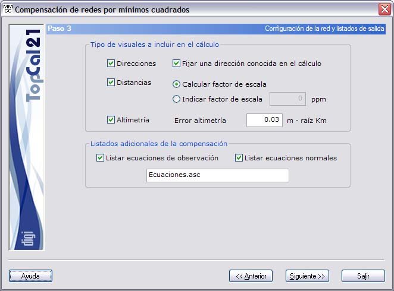

# Step 3: Network and output lists setup
<!-- id: topcal21-compensacion-por-minimos-cuadrados-paso-3-configuracion-de-la-red-y-listados-de-salida -->
<!-- origen: 0d91ae24877eb049fb0ab0e8d49b307f3671f6d8 -->

The third step of the computation is the selection of the type of observations that take part in the computation and of the additional lists wanted from that computation.

To perform a horizontal compensation, two types of equations can be used: **direction** equations and **distance** equations. If only horizontal angles have been measured to compute a network, the network is called a *triangulation*. If only distances have been measured, it is called a *trilateration*. And if both have been measured, a *triangulateration*.

It is possible to **fix known directions in the computation**. This option allows the user to enter azimuths between exactly known points, for example, if they have been measured with a gyroscope.

If, as mentioned before, distances have been measured and there are two or more fixed points, the scale difference in its transmission can be computed by means of the two methods: the base and the distance meter.

If the network is free, you must select the distances to give scale to the network.

The network can also be adjusted in altimetry, and for this the corresponding equations must be selected. The vertical computation is separate from the horizontal one because there is practically no correlation between the XY coordinates and Z.

If a vertical adjustment is selected, you must indicate to the program the **kilometric error** associated with the observations in order to weight them. This value can be computed with the [Computation of random errors](../../calculos/calculo-de-errores-accidentales/README.md) tool.

Finally, it is possible to list, in ASCII format, the equations formed by the program and the various matrices used to solve them, which are stored in the file indicated for that purpose.

Once the relevant options have been selected, you can click the **Next** button to go to [Step 4: Observation selection](paso-4-seleccion-de-visuales.md) or go back to [Step 2: Point selection](paso-2-seleccion-de-puntos.md) by clicking the **Back** button.
