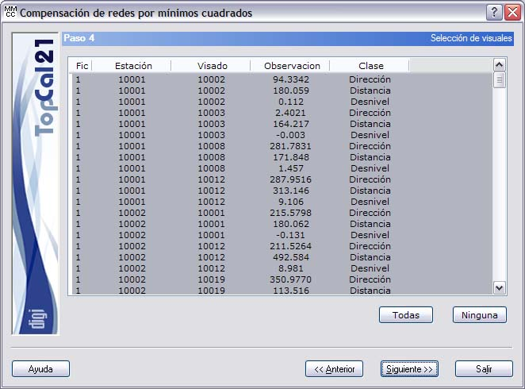

# Step 4: Observation selection
<!-- id: topcal21-compensacion-por-minimos-cuadrados-paso-4-seleccion-de-visuales -->
<!-- origen: b8cacb9e85593d700b380c24c3ca259d32cbc962 -->

The fourth step in the network adjustment is the selection of the observations that make up the computation.

The program shows a list with the observations of the files selected in *Step 1*, distinguishing them by their nature. Thus, there are observations of type *Direction*, *Distance* or *Height difference*, with their respective readings.

This way of presenting the data allows the user to deselect an observation that is not wanted in the computation, depending on the later results, but individually, so that, for example, the distance observation to a given point can be selected but not its angular observation.

In addition, the **Check not selected observations afterwards** checkbox is shown. When it is selected, the program computes the error of the observations that have not been selected in this list using the adjusted coordinates, and writes the list with those errors to the output file, after the reliability test.

Once the desired observations have been selected, you can click the **Next** button to go to the next step. The next step depends on the type of adjustment chosen:

* If a horizontal adjustment was selected, the next step is [Step 5: Weights and residuals of the horizontal observations](paso-5-pesos-y-residuos-de-las-observaciones-planimetricas.md).
* If a horizontal adjustment was not selected, the next step is [Step 8: Weights and residuals of the vertical observations](paso-8-pesos-y-residuos-de-las-observaciones-altimetricas.md).

You can also go back to [Step 3: Network and output lists setup](paso-3-configuracion-de-la-red-y-listados-de-salida.md) by clicking the **Back** button.
