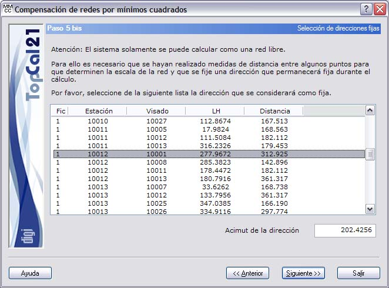

# Step 5.1: Selection of fixed directions in a free network
<!-- id: topcal21-compensacion-por-minimos-cuadrados-paso-5-bis-seleccion-de-direcciones-fijas-en-una-red-libre -->
<!-- origen: f4b0875bbe9436f2eccf5e6da15bfc98b63be868 -->

If the network being adjusted is a free network, in the next step of the adjustment you must select the direction that remains fixed in the adjustment.

This is because the network data do not allow its orientation to be deduced, so the user must determine a direction and its azimuth. It is advisable to choose a direction with a small random error; for this, an observation to a point far from the station is usually chosen, because the direction error is then smaller and the target point can be identified unambiguously.

Once the relevant options have been selected, you can click the **Next** button to go to [Step 6: Displacements and horizontal accuracies](paso-6-desplazamientos-y-precisiones-planimetricas.md) or go back to [Step 5: Weights and residuals of the horizontal observations](paso-5-pesos-y-residuos-de-las-observaciones-planimetricas.md) by clicking the **Back** button.
