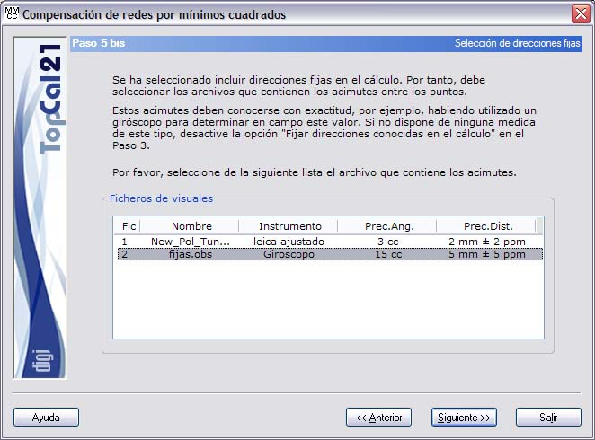

# Step 5.2: Selection of fixed directions
<!-- id: topcal21-compensacion-por-minimos-cuadrados-paso-5-bis-seleccion-de-direcciones-fijas -->
<!-- origen: 24d7507fce326ceb07390f3ee5cad4672a83ece5 -->

If you chose to enter fixed directions, in the next step of the adjustment you must select the file that contains those directions, which remain fixed during the adjustment.

This option is available to enter those directions whose azimuth is known without prior computation, for example, because a gyroscope has been used. The program keeps the azimuth of these directions and modifies the rest of the observations.

Once the relevant options have been selected, you can click the **Next** button to go to [Step 6: Displacements and horizontal accuracies](paso-6-desplazamientos-y-precisiones-planimetricas.md) or go back to [Step 5: Weights and residuals of the horizontal observations](paso-5-pesos-y-residuos-de-las-observaciones-planimetricas.md) by clicking the **Back** button.
