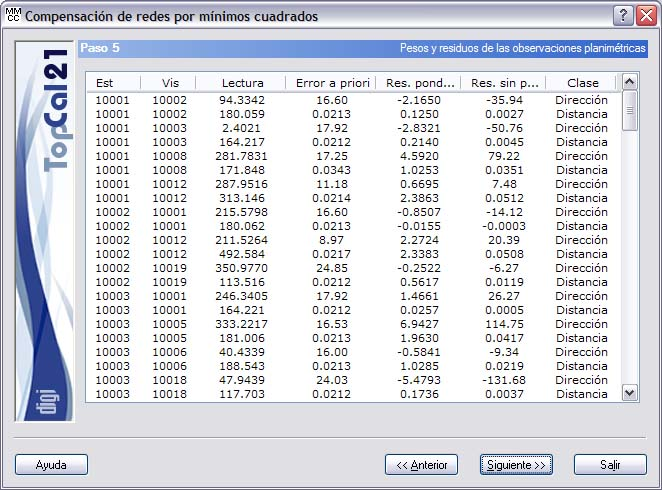

# Step 5: Weights and residuals of the horizontal observations
<!-- id: topcal21-compensacion-por-minimos-cuadrados-paso-5-pesos-y-residuos-de-las-observaciones-planimetricas -->
<!-- origen: 7b65cddcbb34486dc76df2c34de37c2ebb0791e3 -->

In the next step of the adjustment, the program analyzes a priori the horizontal observations that are going to take part in the computation, showing a list with the following data:

* **Station**
* **Target point**
* **Reading**: The units of this field vary depending on the class of the observation: grads for angles and meters for distances.
* **A priori error**: This error is the random error of this observation and depends on the observation distance, the type of instruments and the setup and signaling conditions. As before, the units vary depending on the class of the observation: centesimal seconds for angles and meters for distances.
* **Weighted residual**: This dimensionless value is the result of dividing the non-weighted residual by the a priori error of the observation.
* **Not weighted residual**: This value is the difference between the observed value (the observation itself) and the value computed with the approximate coordinates of the points. The difference may be due to observation errors or to errors in the approximate coordinates. As before, the units vary depending on the class of the observation: centesimal seconds for angles and meters for distances.
* **Class**: The class of the horizontal observations can be *Direction* or *Distance*.

Clicking the header of this list sorts it in ascending or descending order according to the clicked column.

This step is informative only; nothing needs to be selected. You can therefore click the **Next** button to go to the next step. The next step depends on the type of network being adjusted:

* If it is a free network or if you chose to enter a fixed direction, the next step is [Step 5.1: Selection of fixed directions](paso-5-bis-seleccion-de-direcciones-fijas-en-red-libre.md).
* If it is a common network, the next step is [Step 6: Displacements and horizontal accuracies](paso-6-desplazamientos-y-precisiones-planimetricas.md).

You can also go back to [Step 4: Observation selection](paso-4-seleccion-de-visuales.md) by clicking the **Back** button.
