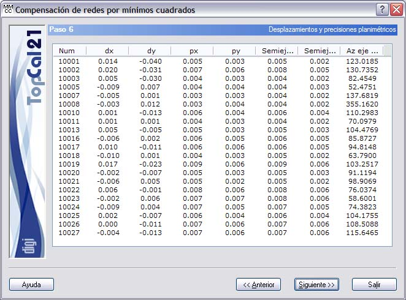

# Step 6: Displacements and horizontal accuracies
<!-- id: topcal21-compensacion-por-minimos-cuadrados-paso-6-desplazamientos-y-precisiones-planimetricas -->
<!-- origen: dde297e0612c193b1ed14c98efb7cfbd0cbefdd3 -->

With the points, the observations and the network characteristics selected, the program adjusts the network and shows the result in this step: the displacements of the coordinates of the non-fixed points and their accuracies.

The displacements depend on the difference between the approximate coordinates and the coordinates obtained in the adjustment. However, the value of these approximate coordinates does not affect the value of the accuracies achieved.

These results are shown in a list, where each line corresponds to a non-fixed point and whose fields are the following:

* **Point number**
* **Displacement for X**: This is the displacement of the approximate X coordinate of the point after the adjustment, in meters.
* **Displacement for Y**: This is the displacement of the approximate Y coordinate of the point after the adjustment, in meters.
* **Accuracy for X**: This is the accuracy achieved for the X coordinate, in meters.
* **Accuracy for Y**: This is the accuracy achieved for the Y coordinate, in meters.
* **Major semiaxis** of the error ellipse, in meters
* **Minor semiaxis** of the error ellipse, in meters
* **Azimuth of the major semiaxis** of the error ellipse, in grads.

If the accuracy of a point could not be computed because of lack of redundancy, the character “?” appears in the fields related to it. Clicking the header of this list sorts it in ascending or descending order according to the clicked column.

After reviewing the computed displacements and horizontal accuracies, you can click the **Next** button to go to [Step 7: Results of the horizontal Baarda test](paso-7-resultados-del-test-de-baarda-planimetrico.md).

You can also go back to the previous step by clicking the **Back** button. This step depends on the type of network being adjusted:

* If it is a free network, the previous step is [Step 5.1: Selection of fixed directions](paso-5-bis-seleccion-de-direcciones-fijas-en-red-libre.md).
* If it is a common network, the previous step is [Step 5: Weights and residuals of the horizontal observations](paso-5-pesos-y-residuos-de-las-observaciones-planimetricas.md).
