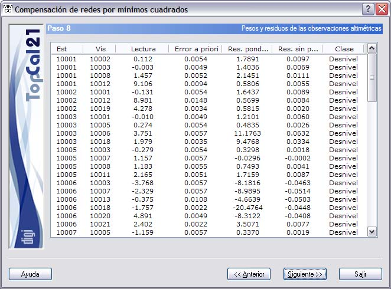

# Step 8: Weights and residuals of the vertical observations
<!-- id: topcal21-compensacion-por-minimos-cuadrados-paso-8-pesos-y-residuos-de-las-observaciones-altimetricas -->
<!-- origen: 04b0cae89f3bc6ff3bbf59fe23e7b181314c1048 -->

In the next step of the adjustment, the program analyzes a priori the vertical observations that are going to take part in the computation, showing a list with the following data:

* **Station**
* **Target point**
* **Reading**: Computed height differences, in meters.
* **A priori error**: This error is the random error of this observation and depends on the observation distance, the type of instruments and the setup and signaling conditions. It is expressed in meters.
* **Weighted residual**: This dimensionless value is the result of dividing the non-weighted residual by the a priori error of the observation.
* **Not weighted residual**: This value is the difference between the observed height difference (the observation itself) and the height difference computed with the approximate coordinates of the points. The difference may be due to observation errors or to errors in the approximate coordinates. It is expressed in meters.
* **Class**: The class of the vertical observations is always *Height difference*.

Clicking the header of this list sorts it in ascending or descending order according to the clicked column.

This step is informative only; nothing needs to be selected. You can therefore click the **Next** button to go to [Step 9: Displacements and vertical accuracies](paso-9-desplazamientos-y-precisiones-altimetricas.md).

You can also go back to the previous step by clicking the **Back** button. This step depends on the type of adjustment chosen:

* If a horizontal adjustment was selected, the previous step is [Step 7: Results of the horizontal Baarda test](paso-7-resultados-del-test-de-baarda-planimetrico.md).
* If a horizontal adjustment was not selected, the previous step is [Step 4: Observation selection](paso-4-seleccion-de-visuales.md).
