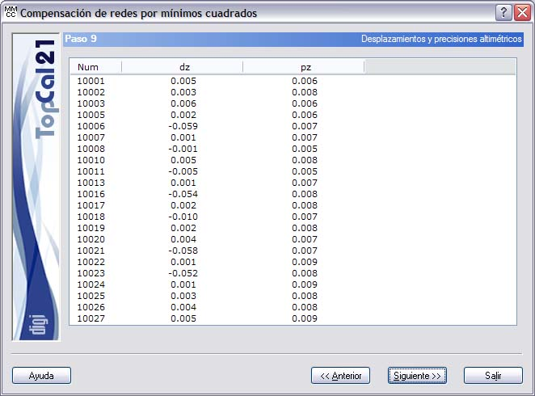

# Step 9: Displacements and vertical accuracies
<!-- id: topcal21-compensacion-por-minimos-cuadrados-paso-9-desplazamientos-y-precisiones-altimetricas -->
<!-- origen: 629ad6d21a254d99260eab638d67d61d8df1f329 -->

In this step, the program adjusts the vertical network and shows the result by presenting the displacements of the coordinates of the non-fixed points and their accuracies.

The displacements depend on the difference between the approximate heights and the heights obtained in the adjustment. However, the value of these approximate heights does not affect the value of the accuracies achieved. As mentioned at the beginning, in the case of the vertical adjustment it is not necessary to have computed approximate coordinates.

These results are shown in a list, where each line corresponds to a non-fixed point and whose fields are the following:

* **Point number**
* **Displacement for Z**: This is the displacement of the approximate Z coordinate of the point after the adjustment, in meters. If no approximate heights are available, this value coincides with the height of the point.
* **Accuracy for Z**: This is the accuracy achieved for the Z coordinate, in meters.

If the accuracy of a point could not be computed because of lack of redundancy, the character “?” appears in this field. Clicking the header of this list sorts it in ascending or descending order according to the clicked column.

This step is informative only; nothing needs to be selected. You can therefore click the **Next** button to go to [Step 10: Results of the vertical Baarda test](paso-10-resultados-del-test-de-baarda-altimetrico.md) or go back to [Step 8: Weights and residuals of the vertical observations](paso-8-pesos-y-residuos-de-las-observaciones-altimetricas.md) by clicking the **Back** button.
