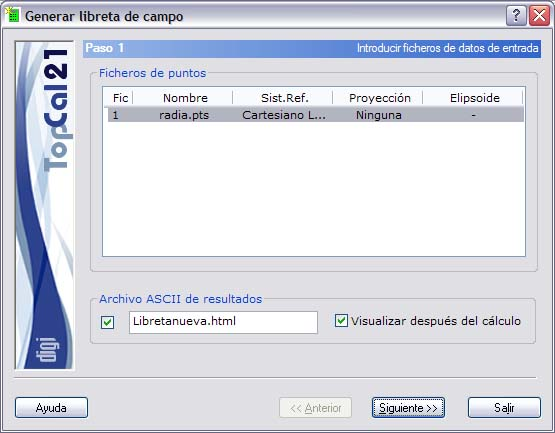

# Step 1: Enter input data files
<!-- id: topcal21-generar-libreta-de-campo-paso-1-introducir-ficheros-de-datos-de-entrada -->
<!-- origen: b6a83a4a6dd2c27e373bad4f7575dae1b22690a6 -->

This is the first step in generating the field notebook. The required data are the following:

* **Point files**: Select the project point files you want to use. The computation can continue only if all the selected point files refer to the same reference system.
* **ASCII output file**: Enter the name of the output file with the results of the computation. This file can be in **html** or **ASCII** format. If the extension of this file is HTM or html, it is treated as html format; otherwise it is treated as ASCII format. You can view this file (with the viewer specified in the [Preferences](../../opciones-de-visualizacion/preferencias.md) dialog box of the [Edit](../../menus-de-la-aplicacion/menu-editar.md) menu) by selecting the check box at the bottom called **Show after computation**. If you do not want to create this file, clear the check box to the left of the name. The file is created in the project directory.

After entering these data, click the **Next** button to go to [Step 2: Station setup](paso-2-configuracion-de-la-estacion.md).
