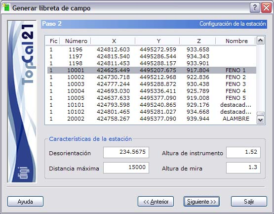

# Step 2: Station setup
<!-- id: topcal21-generar-libreta-de-campo-paso-2-configuracion-de-la-estacion -->
<!-- origen: c8c274b352dd38338f2f6555e98a41763bc77e92 -->

This is the second step in generating the field notebook.

A screen is shown with the points with coordinates stored in the point files selected in *Step 1*. Select only one station point, from which the corresponding observations will be generated.

The list shown contains the following fields:

* **File index**: Indicates the index of the point file where the point is stored.
* **Point number**
* **Point coordinates**
* **Point name**

Once you have selected the station point, specify the following characteristics of the station setup:

* **Orientation**
* **Maximum radiation distance of the points**
* **Instrument height**
* **Prism height**

When you have selected the station, click the **Next** button to go to [Step 3: Target point selection](paso-3-seleccion-de-los-puntos-visados.md), or click the **Back** button to return to [Step 1: Enter input data files](paso-1-introducir-ficheros-de-datos-de-entrada.md).
