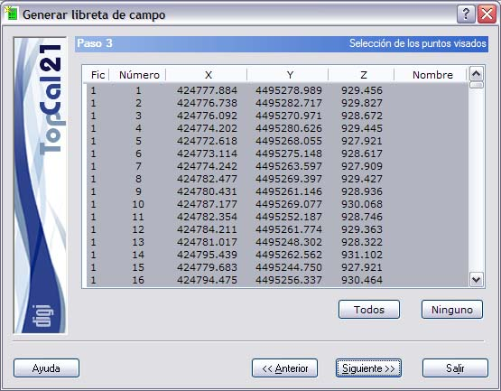

# Step 3: Target point selection
<!-- id: topcal21-generar-libreta-de-campo-paso-3-seleccion-de-los-puntos-visados -->
<!-- origen: 8a99b9ee45c075200e644bf81830948f9736625a -->

This is the third step in generating the field notebook.

A screen is shown with the points stored in the files selected in *Step 1*, except the station selected in *Step 2*. In this step, select the points with which you want to generate the observations.

The list shown contains the following fields:

* **File index**: Indicates the index of the point file where the point is stored.
* **Point number**
* **Point coordinates**
* **Point name**

You can select multiple points by holding down the *\[CTRL\]* key and clicking the desired points with the left mouse button. If you click a point that is already selected, it is deselected.

You can also select points arranged in ranges by holding down the *\[SHIFT\]* key and clicking the left mouse button on the boundary points that define the range.

Likewise, you can use the **All** or **None** buttons to select or deselect all the points.

When you have selected the desired points, click the **Next** button to go to [Step 4: Output data setup](paso-4-configurar-salida-de-datos.md), or click the **Back** button to return to [Step 2: Station setup](paso-2-configuracion-de-la-estacion.md).
