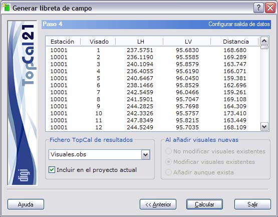

# Step 4: Output data setup
<!-- id: topcal21-generar-libreta-de-campo-paso-4-configurar-salida-de-datos -->
<!-- origen: 48a8d40d8e786d6d906c3ce2683afcff166037c8 -->

This is the fourth and last step in generating the field notebook.

The following fields are shown:

* **List with the generated observations**: Shows the station number, target point number, horizontal angle, vertical angle and slope distance.
* **TopCal output file**: Select the name of the TopCal file where the observations will be stored. You can choose one of the existing files or generate a new file. If you want to generate a new file, you can choose whether or not to add the file to the current project.
* **Adding new observations**: If the observation file is not new, you can choose whether or not to modify the observations with the same station and the same target point that are in the chosen output file, or to add the observations even if they exist with the same station and the same target point.

After you have set up the output data, you can finish the process by clicking the **Compute** button, or return to the previous step, [Step 3: Target point selection](paso-3-seleccion-de-los-puntos-visados.md), by clicking the **Back** button.
