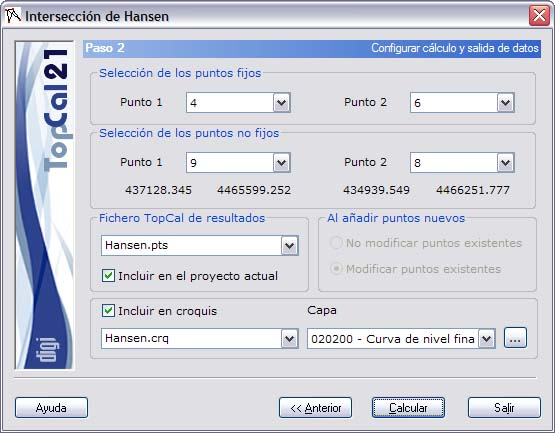

# Step 2: Calculation and output data setup
<!-- id: topcal21-intersecciones-de-hansen-paso-2-configurar-calculo-y-salida-de-datos -->
<!-- origen: f788b1d0993f636178141dcdca1856ca5a4877ca -->

This is the second and last step in computing Hansen intersections.

The screen lets you select the points for the computation and set up the output data, and it shows the computed coordinates. The following fields are shown:

* **Fixed point selection**: Two lists are shown in which you choose the points that are treated as known data in the computation. These points must have their coordinates stored in the point files selected in the previous step. The order of selection does not affect the computation.
* **Not fixed point selection**: Two lists are shown in which you choose the points whose coordinates you want to compute. These lists show only the points that have at least some observations to the chosen fixed points in the observation files selected in the previous step. As you select the fixed points, these lists change, adding the points that meet this condition. However, this condition is not final: to proceed with the computation, the observations between the two non-fixed points must exist. The order of selection does not affect the computation.
* **Results**: The two pairs of XY coordinates are shown for the points considered non-fixed. If the computation could not be performed, a message with the error is shown.
* **TopCal output file**: Select the name of the TopCal file where the points will be stored. You can choose one of the existing files or generate a new file. If you want to generate a new file, you can choose whether or not to add the file to the current project.
* **Adding new points**: If the point file is not new, you can choose whether or not to modify the points that have the same number in the chosen output file.
* **Sketch**: Select the name of the TopCal sketch file where a graphic of the intersection will be recorded. You can choose one of the existing files or generate a new file. You can also specify the **layer** in which the lines of the graphic will be recorded.

After you have set up the output data, you can finish the process by clicking the **Compute** button, or return to the previous step, [Step 1: Enter input files](paso-1-introducir-ficheros-de-datos-de-entrada.md), by clicking the **Back** button.
