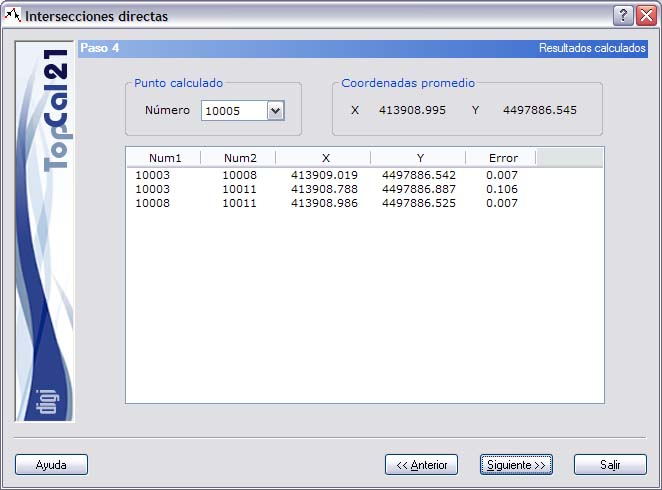

# Step 4: Computed results
<!-- id: topcal21-intersecciones-directas-paso-4-resultados-calculados -->
<!-- origen: e1953ac4b91e279ba0be0ad332dd32b7ebba5281 -->

This is the fourth step in computing the direct intersections.

A screen is shown that displays each of the computed points, whose coordinates are the result of averaging the different simple direct intersections that could be formed. These coordinates appear in the upper right part of the dialog box.

In the central part, a list shows the simple direct intersections made to the point and the semi-major axis of the error ellipse, computed from the instruments and the conditions of each intersection. Click the header of this list to sort it in ascending or descending order by the clicked column.

The average coordinates are used as approximate coordinates to carry out a least-squares computation, whose results are shown in the next step.

This step is informational only; you do not need to select anything. You can therefore go on to the next step, [Step 5: Generated residuals](paso-5-residuos-generados.md), by clicking the **Next** button, or return to the previous step, [Step 3: Observation selection](paso-3-seleccion-de-visuales.md), to make a change by clicking the **Back** button.
