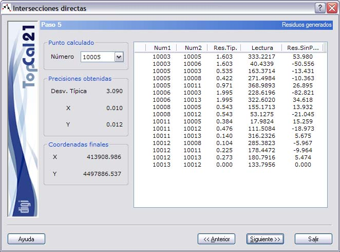
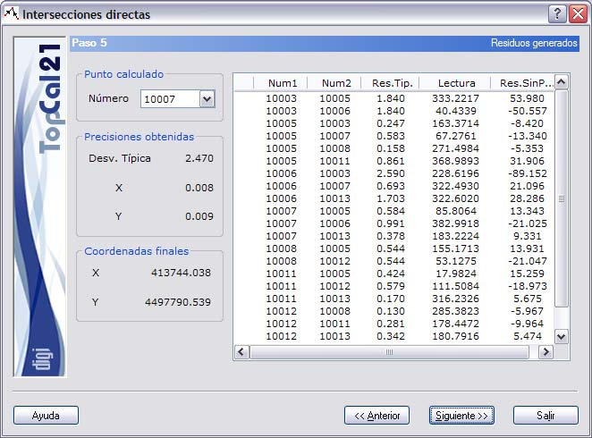

# Step 5: Generated residuals
<!-- id: topcal21-intersecciones-directas-paso-5-residuos-generados -->
<!-- origen: f60546d1e2c55b2411d34edb24b50cf5c63cc959 -->

This is the fifth step in computing the direct intersections.

A screen is shown that displays the computed points and the observations used in the least-squares computation. The fields offered are the following:

* **Computed point**: A list of the different computed points is offered.
* **Observations**: A list shows the different observations, direct and reciprocal, that could take part in the least-squares computation of the point coordinates. The station point and target point of the observation and the standardized residual of the observation are shown. For more information about the standardized residual, see [Step 7 of Compensation by least squares](../compensacion-por-minimos-cuadrados/paso-7-resultados-del-test-de-baarda-planimetrico.md). If the residual is greater than the critical value 3.29, it is flagged with a mark (\*). If the quality of the observation could not be checked, the character “?” appears. If the observation is flagged, it should not be used to compute the final coordinates, so it should be deselected in *Step 3*. Click the header of this list to sort it in ascending or descending order by the clicked column.
* **Accuracy obtained**: Shows information about the standard deviation reached with the least-squares computation and the accuracies reached in each of the coordinates.
* **Final coordinates**: Coordinates resulting from applying a least-squares adjustment with all the observations (direct and reciprocal) that could help in the computation of the point coordinates.

This step is informational only; you do not need to select anything. You can therefore go on to the next step, [Step 6: Output data setup](paso-6-configurar-salida-de-datos.md), by clicking the **Next** button, or return to the previous step, [Step 4: Computed results](paso-4-resultados-calculados.md), to make a change by clicking the **Back** button.
