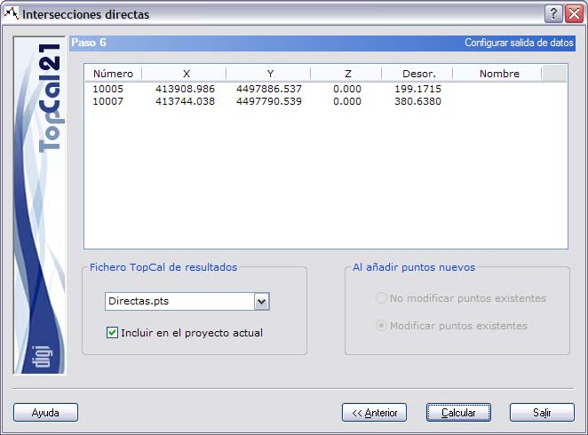

# Step 6: Output data setup
<!-- id: topcal21-intersecciones-directas-paso-6-configurar-salida-de-datos -->
<!-- origen: 6cad92398ba5dd526ac7b554a0224e4028a70d6f -->

This is the sixth and last step in computing direct intersections.

A screen is shown with the final computed coordinates and the way to save them. The following fields are shown:

* **Final coordinates**: A list shows the new computed points, their coordinates and their orientation.
* **TopCal output file**: Select the name of the TopCal file where the points will be stored. You can choose one of the existing files or generate a new file. If you want to generate a new file, you can choose whether or not to add the file to the current project.
* **Adding new points**: If the point file is not new, you can choose whether or not to modify the points that have the same number in the chosen output file.

After you have set up the output data, you can finish the process by clicking the **Compute** button, or return to the previous step, [Step 5: Generated residuals](paso-5-residuos-generados.md), by clicking the **Back** button.
