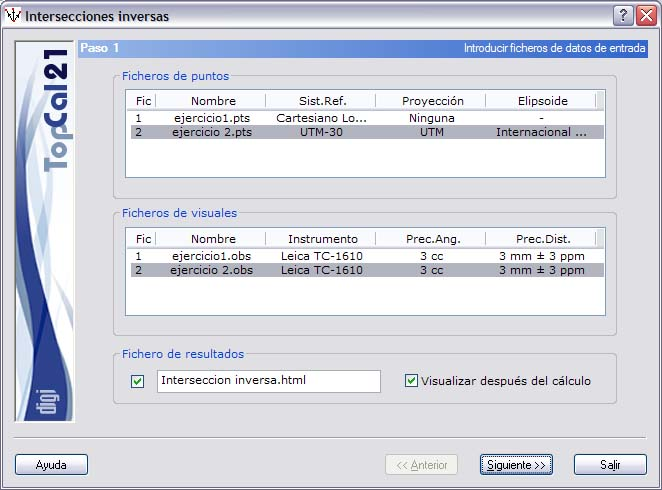

# Step 1: Enter input data files
<!-- id: topcal21-intersecciones-inversas-paso-1-introducir-ficheros-de-datos-de-entrada -->
<!-- origen: ad7653ccff205dff7176cd7096744afb55ed27cb -->

This is the first step in computing 3-point resections. The required data are the following:

* **Point files**: Select the project point files to be used in the resections. The computation can only continue if all the selected point files refer to the same reference system.
* **Observation files**: Select the project observation files that contain the observations used in the computation.
* **ASCII output file**: Enter the name of the output file with the results of the computation. This file can be in **html** format or **ASCII** format. If the extension of this file is HTM or html, the format is html; otherwise the format is ASCII. This file can be viewed (with the viewer specified in the [Preferences](../../opciones-de-visualizacion/preferencias.md) dialog box of the [Edit](../../menus-de-la-aplicacion/menu-editar.md) menu) if you select the checkbox at the bottom named **Show after computation**. If you do not want to create this file, clear the checkbox to the left of the name. The file is created in the project directory.

Once these data have been entered, you can click the **Next** button to go to [Step 2: Point selection](paso-2-seleccion-de-puntos.md).
