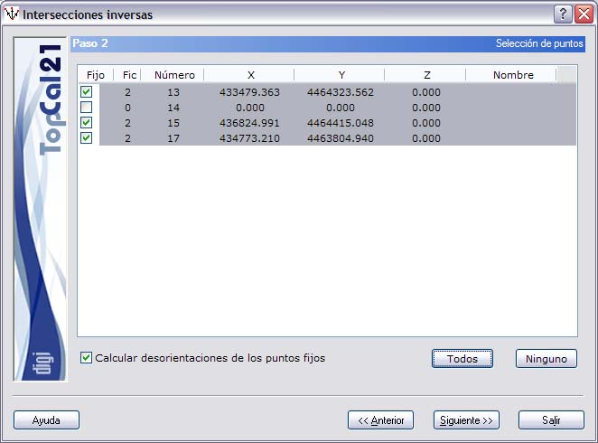

# Step 2: Point selection
<!-- id: topcal21-intersecciones-inversas-paso-2-seleccion-de-puntos -->
<!-- origen: fe684a945af6aa687edb4a5b25541b5284252bc0 -->

This is the second step in computing 3-point resections.

A screen shows the points with coordinates stored in the point files selected in *Step 1*, together with the points that are sighted from those points or that sight those points and whose observations are in the observation files selected in *Step 1*.

The list contains the following fields:

* **Fixed checkbox**: This checkbox indicates whether the point is fixed or not, depending on whether it is selected or not. To select or clear it, double-click the desired point with the left mouse button.
* **File index**: Indicates the index of the point file where the point is stored. If this field is equal to 0, it means that the point currently has no coordinates and, therefore, is not stored in any file, but there are observations from or to points of known coordinates.
* **Point number**
* **Point coordinates**
* **Point name**

Multiple points can be selected by holding down the *\[CTRL\]* key and clicking the desired points with the left mouse button. If you click a point that is already selected, it is deselected.

Points arranged in ranges can also be selected by holding down the *\[SHIFT\]* key and clicking with the left mouse button the limit points that define the range.

In the same way, you can use the **All** or **None** buttons to select or deselect all the points.

Once the desired points have been selected, you can click the **Next** button to go to [Step 3: Observation selection](paso-3-seleccion-de-visuales.md) or go back to [Step 1: Enter input data files](paso-1-introducir-ficheros-de-datos-de-entrada.md) by clicking the **Back** button.
