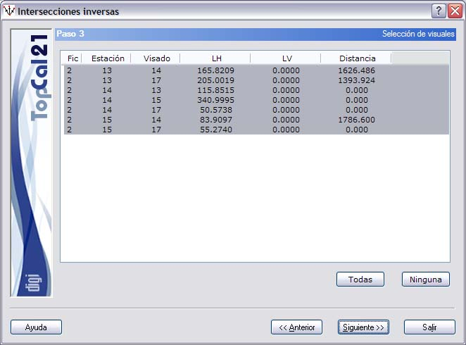

# Step 3: Observation selection
<!-- id: topcal21-intersecciones-inversas-paso-3-seleccion-de-visuales -->
<!-- origen: 8f7f8df3f91e92cfc35ebb1c7085d8a7e569bf6f -->

This is the third step in computing 3-point resections.

A screen shows the observations stored in the observation files selected in *Step 1* and in which points selected in *Step 2* take part.

The list contains the following fields:

* **File index**: Indicates the index of the observation file where the observation is stored.
* **Station point number**
* **Target point number**
* **Horizontal angle**
* **Vertical angle**
* **Distance**: It is shown but not used in the computation

Multiple observations can be selected by holding down the *\[CTRL\]* key and clicking the desired observations with the left mouse button. If you click an observation that is already selected, it is deselected.

Observations arranged in ranges can also be selected by holding down the *\[SHIFT\]* key and clicking with the left mouse button the limit observations that define the range.

In the same way, you can use the **All** or **None** buttons to select or deselect all the observations.

Once the desired observations have been selected, you can click the **Next** button to go to [Step 4: Computed results](paso-4-resultados-calculados.md) or go back to [Step 2: Point selection](paso-2-seleccion-de-puntos.md) by clicking the **Back** button.
