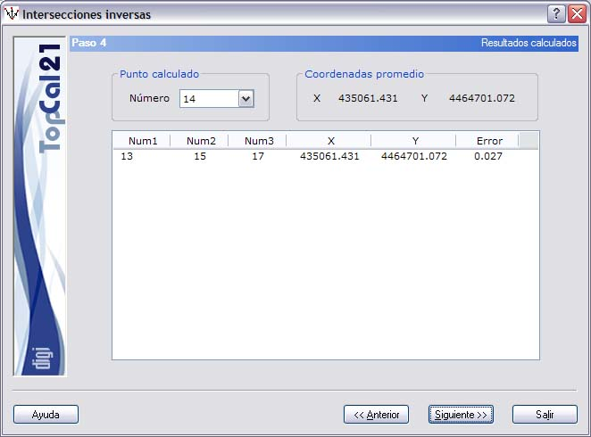

# Step 4: Computed results
<!-- id: topcal21-intersecciones-inversas-paso-4-resultados-calculados -->
<!-- origen: c86145c17488dce318baaf0832cd7c80ddf1d7a1 -->

This is the fourth step in computing 3-point resections.

A screen shows each of the computed points, whose coordinates are the result of averaging the different simple 3-point resections that could be formed. These coordinates appear in the upper right part of the dialog box.

In the central part, a list is shown with the simple 3-point resections made from the point and the major semiaxis of the error ellipse computed from the instruments and the conditions of each resection. Clicking the header of this list sorts it in ascending or descending order according to the clicked column.

The average coordinates are used as approximate coordinates to proceed with a least-squares computation, whose results are shown in the next step.

This step is informative only; nothing needs to be selected. You can therefore go to the next step, [Step 5: Generated residuals](paso-5-residuos-generados.md), by clicking the **Next** button, or go back to the previous step, [Step 3: Observation selection](paso-3-seleccion-de-visuales.md), to make some change by clicking the **Back** button.
