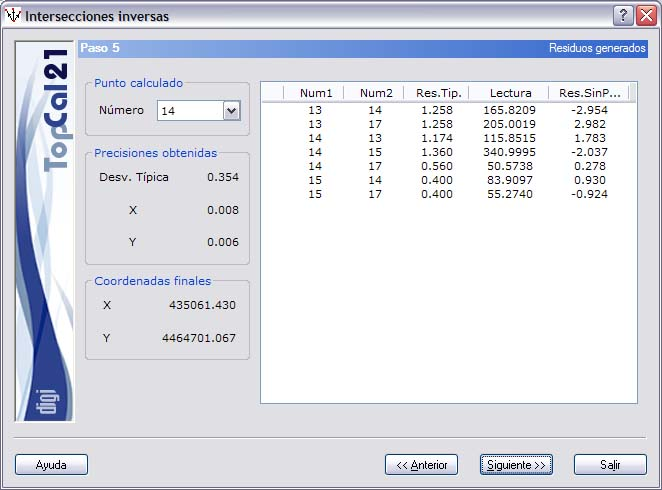

# Step 5: Generated residuals
<!-- id: topcal21-intersecciones-inversas-paso-5-residuos-generados -->
<!-- origen: edcb7d975fc0ec9c6cfb3265cceec577892c6707 -->

This is the fifth step in computing 3-point resections.

A screen shows the computed points and the observations used for the least-squares computation. The fields offered are the following:

* **Computed point**: A list with the different computed points is offered.
* **Observations**: A list is shown with the different observations, forward and reverse, that could take part in the least-squares computation of the coordinates of the point. The station and target points of the observation and the standardized residual of the observation are shown. For more information about the standardized residual, see [Step 7 of Compensation by least squares](../compensacion-por-minimos-cuadrados/paso-7-resultados-del-test-de-baarda-planimetrico.md). If the residual is greater than the critical value 3.29, it is flagged with a mark (\*). If the goodness of fit of the observation could not be checked, the character “?” appears. If the observation is marked, it should not be used to compute the final coordinates, so it should be deselected in *Step 3*. Clicking the header of this list sorts it in ascending or descending order according to the clicked column.
* **Accuracy obtained**: Shows information about the standard deviation achieved with the least-squares computation and the accuracies achieved for each of the coordinates.
* **Final coordinates**: Coordinates resulting from applying a least-squares adjustment with all the observations (forward and reverse) that could help in computing the coordinates of the point.

This step is informative only; nothing needs to be selected. You can therefore go to the next step, [Step 6: Output data setup](paso-6-configurar-salida-de-datos.md), by clicking the **Next** button, or go back to the previous step, [Step 4: Computed results](paso-4-resultados-calculados.md), to make some change by clicking the **Back** button.
