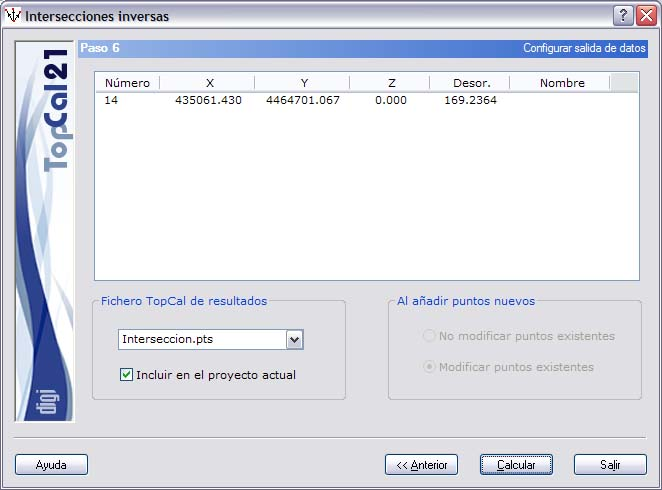

# Step 6: Output data setup
<!-- id: topcal21-intersecciones-inversas-paso-6-configurar-salida-de-datos -->
<!-- origen: dcd98763dae39011a09a8492e860b480caabb2aa -->

This is the sixth and last step in computing 3-point resections.

A screen is shown with the final computed coordinates and the way to save them. The following fields are shown:

* **Final coordinates**: A list is shown with the new computed points, their coordinates and their orientation.
* **TopCal output file**: You can select the name of the TopCal file where the points are stored. You can choose one of the existing files or generate a new file. If you want to generate a new file, you can choose whether or not to add the file to the current project.
* **Adding new points**: If the point file is not new, you can choose whether or not to modify the points with the same number found in the chosen output file.

Once the output data have been set up, you can finish the process by clicking the **Calculate** button or go back to the previous step, [Step 5: Generated residuals](paso-5-residuos-generados.md), by clicking the **Back** button.
