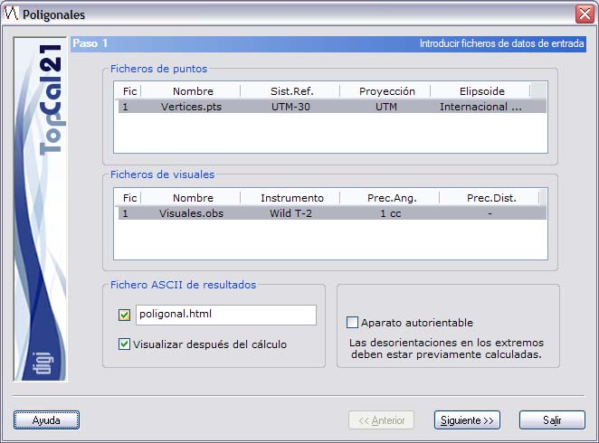

# Step 1: Enter input data files
<!-- id: topcal21-poligonales-paso-1-introducir-ficheros-de-datos-de-entrada -->
<!-- origen: bf8d5877e94b28981a50441714aa0887aa5e93d2 -->

This is the first step in computing traverses. The required data are the following:

* **Point files**: Select the project point files you want to use in the traverse. You can only continue the computation if all the selected point files refer to the same reference system.
* **Observation files**: Select the project observation files that contain the observations used in the computation.
* **ASCII output file**: Enter the name of the output file with the results of the computation. This file can be in **html** or **ASCII** format. If the extension of this file is HTM or html, it is treated as html format; otherwise it is treated as ASCII format. You can view this file (with the viewer specified in the [Preferences](../../opciones-de-visualizacion/preferencias.md) dialog of the [Edit](../../menus-de-la-aplicacion/menu-editar.md) menu) if you select the checkbox at the bottom named **Show after computation**. If you do not want to create this file, clear the checkbox to the left of the name. The file is created in the project directory.
* **Use scale factor**: If the reference system of the selected point files is local, you can select this checkbox if you want to compute the distances using that factor. It is useful when you are not using a projected system but you want to reduce the distances to simulate the computation in UTM projection. It is only displayed when you select files without a projected system.
* **Gyroscope or compass**: Select this field only if you have a self-orienting instrument, such as a traverse run with a compass or a gyroscope. If you select this checkbox, the orientation at the first point is used, together with the instrument's magnetic declination, at all points. Not all observations need to have a reciprocal, but there must be at least one observation in each traverse line.

Once you have entered these data, click the **Next** button to go to [Step 2: Point selection](paso-2-seleccion-de-puntos.md).
