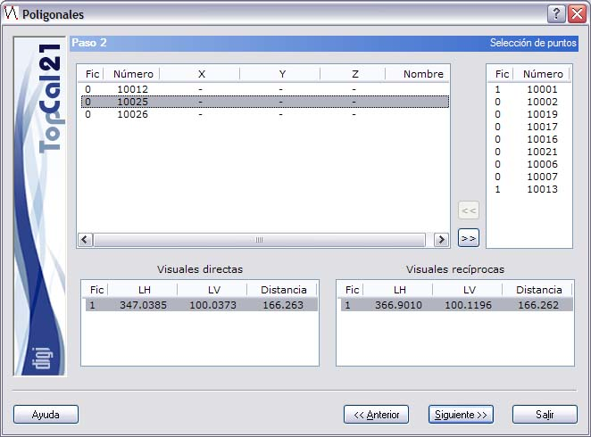

# Step 2: Point selection
<!-- id: topcal21-poligonales-paso-2-seleccion-de-puntos -->
<!-- origen: 4cf4f5eb9313683e1a087399066af0990c4e531c -->

This is the second step in computing traverses.

A screen with four lists is displayed:

* **List of available points**: This list is in the upper left part and shows all the points available in the files selected in *Step 1*. In this list, select the points that will make up the traverse. To add a point to the traverse, double-click the desired point, or select the point and click the **>>** button. If the traverse is not an alternate traverse, a point can only be added if there are observations between this point and the previous one (unless it is the first point). This list is updated according to the current station of the traverse, so it only shows the target points observed from that station, at which the instrument has been set up and from which the current station has been observed, that is, points that have a reciprocal observation. This list shows the following fields:
  * **File index**: The index of the point file where the point is stored. If this field is 0, the point currently has no coordinates and therefore is not stored in any file, but there are observations from the previous station to this point.
  * **Point number**
  * **Point coordinates**
* **List of points making up the traverse**: This list is in the upper right part and shows the points that make up the traverse, ordered along the course of the traverse. To remove a point from the traverse, click the **&lt;&lt;** button. If you remove a point from the middle of the traverse, all the points after it are removed. This list shows the following fields:
  * **File index**: The index of the point file the point belongs to.
  * **Point number**
* **List of direct observations (foresight)**: This list is in the lower left part and shows the observations available from the last station of the traverse to the point selected in the list of available points. If there are several observations, you can choose which observation to use in the computation. This list shows the following fields:
  * **File index**
  * **Horizontal angle**
  * **Vertical angle**
  * **Distance**
* **List of reciprocal observations (backsight)**: This list is in the lower right part and shows the observations available from the point selected in the list of available points to the last station of the traverse. If there are several observations, you can choose which observation to use in the computation. This list shows the following fields:
  * **File index**
  * **Horizontal angle**
  * **Vertical angle**
  * **Distance**

Only one distance is required on each axis. If two distances exist (direct and reciprocal), they are reduced and their average is used.

The **Next** button is enabled when the traverse contains at least one axis. Traverses can be:

* **Open** or **closed-loop**: They are closed-loop when the departure station is the same as the arrival station. Otherwise they are open. If the traverse is closed-loop and the distance meter used has a systematic error, the closure does not allow you to detect that error.
* **Closed between known stations** or **not closed between known stations**: They are closed between known stations when the coordinates of the departure and arrival stations are known. Otherwise they are not closed between known stations. In the latter case, the closure errors of the traverse cannot be computed.

When the traverse has been made up, click the **Next** button to go to [Step 3: Comparison of distances and height differences](paso-3-comprobacion-de-distancias-y-desniveles.md), or click the **Back** button to return to [Step 1: Enter input data files](paso-1-introducir-ficheros-de-entrada.md).
