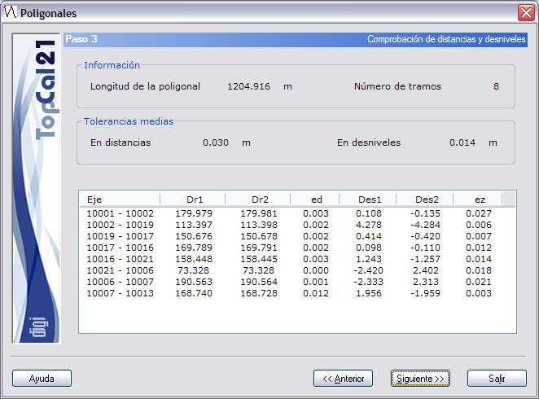

# Step 3: Comparison of distances and height differences
<!-- id: topcal21-poligonales-paso-3-comprobacion-de-distancias-y-desniveles -->
<!-- origen: c5d80732c3fdf01525199e4fc986f14c156c2823 -->

This is the third step in computing traverses. This step shows information about the computed traverse: the different axes with the measured distances and height differences. In this way, you can compare them and check whether they are acceptable for this type of observation and this instrument.

If the traverse is an alternate traverse, only one distance and one height difference are shown for each axis.

At the top of the dialog box, the total **Length of the traverse** and the **Number of traverse lines** are shown. Below them are the **average tolerances in distances and height differences**. The difference between direct and reciprocal distances, and between direct and reciprocal height differences, respectively, should not exceed these values.

Next, the information about the axes is shown, organized in the following fields:

* Axis
* Direct reduced distance
* Reciprocal reduced distance
* Difference between both distances
* Direct height difference
* Reciprocal height difference
* Difference between both height differences

When you reach this step, the program has already computed the traverse and shows the first results, in this case the checks. Make sure that these errors stay within the computed tolerances, because for each traverse line the program averages the direct and reciprocal distance measurements, and the direct and reciprocal height differences, to compute the coordinates of the stations. If any of the axes is not acceptable in distance or height difference and you identify the error (in the direct or reciprocal observation), you can disable that observation by setting the vertical field or the distance to zero in the original observation file.

If you accept the data obtained, click the **Next** button to go to [Step 4: Results and closures](paso-4-resultados-y-cierres.md), or click the **Back** button to return to [Step 2: Point selection](paso-2-seleccion-de-puntos.md).
