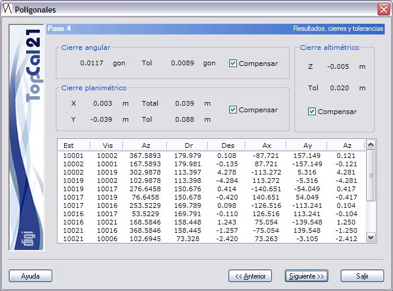

# Step 4: Results and closures
<!-- id: topcal21-poligonales-paso-4-resultados-y-cierres -->
<!-- origen: 94d1e51c2ce8edcaecb8e7f3a8883057649b1143 -->

This is the fourth step in computing traverses. This step shows more information about the computed traverse: the different axes and the closure errors obtained. If the results are not the desired ones, you can go back to the previous steps to make the appropriate changes.

If the traverse is not closed between known stations, the closure errors are not shown, so the quality of the observation cannot be checked.

The information is organized in the following fields:

* **Angular closure**: The angular closure error obtained when computing the traverse. To its right, the **tolerance** is shown, computed according to the observation conditions and the instruments used. This error can be compensated over the different axes by selecting the **Compensate** checkbox. When you select or clear this checkbox, the data are recomputed immediately.
* **Planimetric closure**: The closure errors in X and Y obtained when computing the traverse. To the right, the **total error** is shown, as the quadratic component of both errors, together with the maximum **tolerance**. These errors can be compensated over the different axes in proportion to their distance by selecting the **Compensate** checkbox. When you select or clear this checkbox, the data are recomputed immediately.
* **Altimetric closure**: The closure error in Z obtained when computing the traverse. The maximum **tolerance** for this closure is shown at the bottom. This error can be compensated over the different axes in proportion to their distance by selecting the **Compensate** checkbox. When you select or clear this checkbox, the data are recomputed immediately.
* **List of axes**: The data offered are the following:
  * *Station number*
  * *Target point number*
  * *Azimuth*
  * *Reduced distance*
  * *Height difference*
  * *Ax*: Increment in the X coordinate of the axis
  * *Ay*: Increment in the Y coordinate of the axis
  * *Az*: Increment in the Z coordinate of the axis

This step shows the results together with the closure errors. These errors can be compensated or not in real time, so if you clear any of the compensation checkboxes, all the computations in the lower list change.

If you accept the data obtained, click the **Next** button to go to [Step 5: Output data setup](paso-5-configurar-salidas-de-datos.md), or click the **Back** button to return to [Step 2: Point selection](paso-2-seleccion-de-puntos.md).
