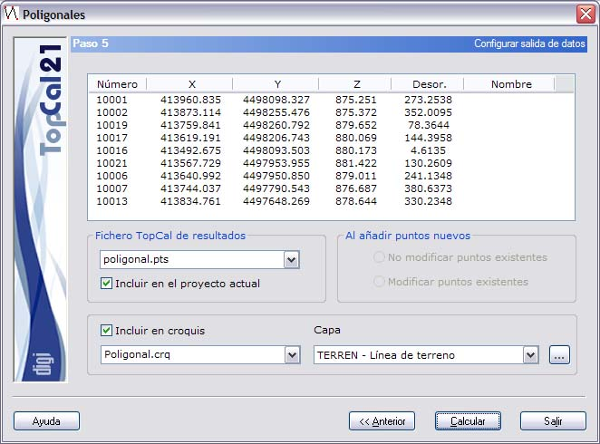

# Step 5: Output data setup
<!-- id: topcal21-poligonales-paso-5-configurar-salida-de-datos -->
<!-- origen: d763f1523fe9573d38ea3d00be1bacaa8ef08d84 -->

This is the fifth and last step in computing traverses.

A screen is shown with the final computed coordinates and the way to save them. In addition, you can generate a sketch with the location of the stations of the traverse. The following fields are displayed:

* **Final coordinates**: A list of the new computed points, their coordinates and their orientation.
* **TopCal output file**: Select the name of the TopCal file where the points are stored. You can choose one of the existing files or generate a new one. If you want to generate a new file, you can choose whether or not to add the file to the current project.
* **Adding new points**: If the point file is not new, you can choose whether or not to modify the points with the same number that are in the chosen output file.
* **Sketch**: Select the name of the TopCal sketch file where a line joining the different stations of the traverse is recorded. You can choose one of the existing files or generate a new one. In addition, you can specify the **layer** in which that line is recorded.

Once you have set up the output data, click the **Compute** button to finish the process, or click the **Back** button to return to the previous step, [Step 4: Results and closures](paso-4-resultados-y-cierres.md).
