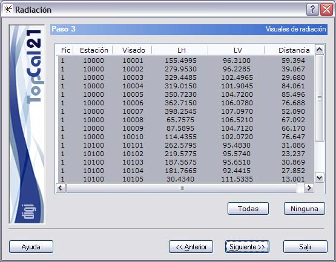

# Step 3: Observation selection
<!-- id: topcal21-radiacion-paso-3-seleccion-de-visuales -->
<!-- origen: 256977888cf06f7c47acdb0ef26f286295645f1c -->

This is the third step in computing the radial survey.

A screen is shown with the observations stored in the observation files selected in *Step 1* whose stations are the ones selected in *Step 2*. In this step, select which points you want to compute and with which observations.

The list shown contains the following fields:

* **File index**: Indicates the index of the observation file where the observation is stored.
* **Station point number**
* **Target point number**
* **Horizontal angle**
* **Vertical angle**
* **Distance**

You can select multiple observations by holding down the *\[CTRL\]* key and clicking the desired observations with the left mouse button. If you click an observation that is already selected, it is deselected.

You can also select observations arranged in ranges by holding down the *\[SHIFT\]* key and clicking the left mouse button on the boundary observations that define the range.

Likewise, you can use the **All** or **None** buttons to select or deselect all the observations.

When you have selected the desired observations, click the *Next* button to go to [Step 4: Output data setup](paso-4-configurar-salida-de-datos.md), or click the *Back* button to return to [Step 2: Point selection](paso-2-seleccion-de-puntos.md).
