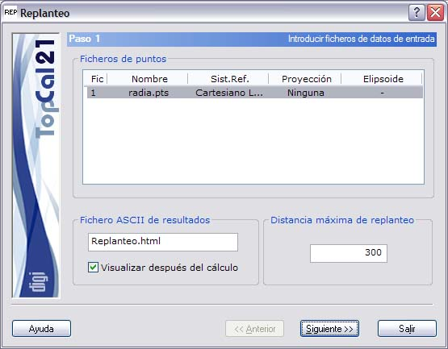

# Step 1: Enter input data files
<!-- id: topcal21-replanteo-paso-1-introducir-ficheros-de-datos-de-entrada -->
<!-- origen: acdc40956c95f2c8405a5df741de10751af82933 -->

This is the first step in computing the stakeout data. The required data are the following:

* **Point files**: Select the project point files you want to use in the stakeout. The computation can continue only if all the selected point files refer to the same reference system.
* **Stakeout maximum distance**: Specify the default maximum distance from a station to a target point. You can change this distance individually for each station in Step 2. Beyond that distance, the stakeout data are not computed from a given station.
* **ASCII output file**: Enter the name of the output file with the results of the computation. This file can be in **html** or **ASCII** format. If the extension of this file is HTM or html, it is treated as html format; otherwise it is treated as ASCII format. You can view this file (with the viewer specified in the [Preferences](../../opciones-de-visualizacion/preferencias.md) dialog box of the [Edit](../../menus-de-la-aplicacion/menu-editar.md) menu) by selecting the check box at the bottom called **Show after computation**. The file is created in the project directory.

After entering these data, click the **Next** button to go to [Step 2: Station point selection](paso-2-seleccion-de-puntos-estacion.md).
