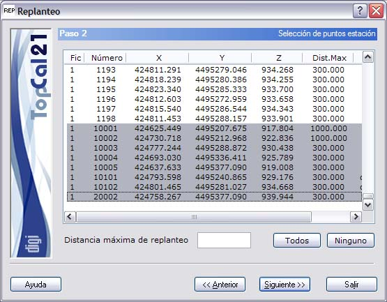

# Step 2: Station point selection
<!-- id: topcal21-replanteo-paso-2-seleccion-de-puntos-estacion -->
<!-- origen: 50cf6029ea780863f88bef8dc9ae285f470225f6 -->

This is the second step in computing the stakeout data.

A screen is shown with the points with coordinates stored in the point files selected in *Step 1*. Select the station points from which the stakeout data for the remaining points will be computed.

The list shown contains the following fields:

* **File index**: Indicates the index of the point file where the point is stored.
* **Point number**
* **Point coordinates**
* **Stakeout maximum distance**

You can select multiple points by holding down the *\[CTRL\]* key and clicking the desired points with the left mouse button. If you click a point that is already selected, it is deselected.

You can also select points arranged in ranges by holding down the *\[SHIFT\]* key and clicking the left mouse button on the boundary points that define the range.

Likewise, you can use the **All** or **None** buttons to select or deselect all the points.

In addition, a field called **Stakeout maximum distance** appears, which is useful for changing the distance for each station independently. If you want to change this distance for several points, select the desired points and enter the new distance; it is updated for all of them.

When you have selected the desired points, click the **Next** button to go to [Step 3: Target point selection](paso-3-seleccion-de-puntos-visados.md), or click the **Back** button to return to [Step 1: Enter input data files](paso-1-introducir-ficheros-de-datos-de-entrada.md).
