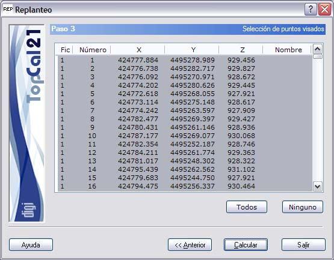

# Step 3: Target point selection
<!-- id: topcal21-replanteo-paso-3-seleccion-de-puntos-visados -->
<!-- origen: d9dacbef596ce390ace912c498e6d76ff3e455c2 -->

This is the third and last step in computing the stakeout data.

A screen is shown with the points with coordinates stored in the point files selected in *Step 1* that have not been selected as station points in *Step 2*. Now, select the target points for which the stakeout data will be computed from the station points selected in the previous step.

The list shown contains the following fields:

* **File index**: Indicates the index of the point file where the point is stored.
* **Point number**
* **Point coordinates**

You can select multiple points by holding down the *\[CTRL\]* key and clicking the desired points with the left mouse button. If you click a point that is already selected, it is deselected.

You can also select points arranged in ranges by holding down the *\[SHIFT\]* key and clicking the left mouse button on the boundary points that define the range.

Likewise, you can use the **All** or **None** buttons to select or deselect all the points.

Once you have set up the output data, you can finish the process by clicking the **Compute** button, or return to the previous step, [Step 2: Station point selection](paso-2-seleccion-de-puntos-estacion.md), by clicking the **Back** button.
