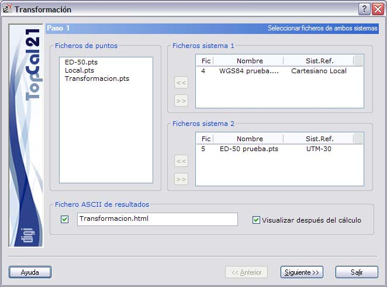

# Step 1: Reference system files selection
<!-- id: topcal21-transformacion-paso-1-seleccionar-ficheros-de-ambos-sistemas -->
<!-- origen: b9ed0b80b8767ac5fe53bf03c7bea5fda3d7900d -->

This is the first step in computing the transformation. The required data are the following:

* **Point files**: Select the project point files you want to use in the transformation. Use the **>>** buttons on the right side of the box to select which files belong to coordinate system 1 and which files belong to coordinate system 2.
* **Files system 1**: These files contain the common points needed to transform the points of system 2 into system 1.
* **Files system 2**: These files contain the common points needed to transform the non-common points of these files into system 1.
* **ASCII output file**: Enter the name of the output file with the results of the computation. This file can be in **html** or **ASCII** format. If the extension of this file is HTM or html, it is treated as html format; otherwise it is treated as ASCII format. You can view this file (with the viewer specified in the [Preferences](../../opciones-de-visualizacion/preferencias.md) dialog of the [Edit](../../menus-de-la-aplicacion/menu-editar.md) menu) if you select the checkbox at the bottom named **Show after computation**. If you do not want to create this file, clear the checkbox to the left of the name. The file is created in the project directory.

Once you have entered these data, click the **Next** button to go to [Step 2: Common points to both systems](paso-2-puntos-comunes-a-ambos-sistemas.md).
