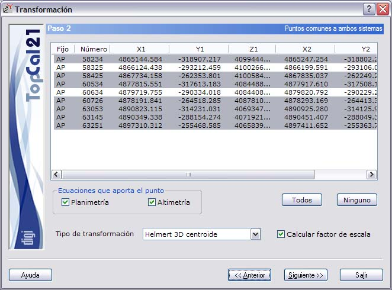

# Step 2: Common points to both systems
<!-- id: topcal21-transformacion-paso-2-puntos-comunes-a-ambos-sistemas -->
<!-- origen: edf44ee2da96c4185e6c2d21488ea73fdc616a03 -->

This is the second step in computing the transformation.

A screen is shown with the points common to both systems that belong to the point files selected in *Step 1*. Select the points that will be used to perform the transformation.

At the bottom of the dialog box, the type of transformation to be performed is indicated:

* **Helmert 2 dimensions**: Rotations and translations are computed from the coordinate origin. The system has four unknowns and each point contributes two equations to the system.
* **Helmert 3 dimensions**: Rotations and translations are computed from the coordinate origin. The system has seven unknowns and each point contributes three equations to the system.
* **Helmert 2 dimensions centroid**: The centers of mass of the two systems are computed; the translations are the difference between the two points and the rotations are referred to them. The system has four unknowns and each point contributes two equations to the system.
* **Helmert 3 dimensions centroid**: The centers of mass of the two systems are computed; the translations are the difference between the two points and the rotations are referred to them. The system has seven unknowns and each point contributes three equations to the system.
* **Affine 2 dimensions**: Rotations and translations are computed from the coordinate origin. The system has six unknowns and each point contributes two equations to the system.
* **Affine 2 dimensions centroid**: The centers of mass of the two systems are computed; the translations are the difference between the two points and the rotations are referred to them. The system has six unknowns and each point contributes two equations to the system.
* **Translation XY**: Only the planimetric translation is computed. The system has two unknowns and each point contributes two equations.
* **Translation Z**: Only the altimetric translation is computed. The system has one unknown and each point contributes one equation.
* **Translation 3D**: The translation in space is computed. The system has three unknowns and each point contributes three equations.

If the selected type of transformation is 3 dimensions, the program lets the user select which points contribute equations in planimetry and altimetry. To do this, two checkboxes are shown at the bottom of the dialog box; you can select or clear them while the points you want to modify are selected.

For this type of transformation, the list shows an additional field on the left that indicates which equations each point contributes: if the letter **P** appears, the point contributes equations in planimetry; if the letter **A** appears, the point contributes equations in altimetry.

This selection of equations is useful because it lets you remove from the system those coordinates that add too much error to the computation.

In addition, there is another checkbox in the dialog box that lets the user choose whether or not to include the scale factor unknown in the system.

The list shown contains the following fields:

* **Point number**
* **Coordinates in system 1**
* **Coordinates in system 2**

Depending on the type of transformation chosen, the XY coordinates (2 dimensions), the Z coordinate (altimetric translation) or the XYZ coordinates (3 dimensions) are shown in both systems.

You can select multiple points by holding down the *\[CTRL\]* key and clicking the desired points with the left mouse button. If you click a point that is already selected, the program deselects that point.

You can also select ranges of points by holding down the *\[SHIFT\]* key and clicking with the left mouse button the limit points that define the range.

In the same way, you can use the **All** or **None** buttons to select all points or deselect all points, respectively.

When you have selected the desired points, click the **Next** button to go to [Step 3: Residuals](paso-3-puntos-transformados-y-residuos.md), or click the **Back** button to return to [Step 1: Reference system files selection](paso-1-seleccionar-ficheros-de-ambos-sistemas.md).
