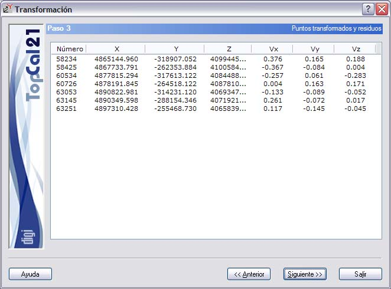

# Step 3: Residuals
<!-- id: topcal21-transformacion-paso-3-residuos -->
<!-- origen: fd07d1674624379702f212fed7d3ad68305f63f1 -->

This is the third step in computing the transformation.

A screen is shown with the transformed common points. The list shown contains the following fields:

* **Point number**
* **Residuals** of the coordinates of the transformed common points. The characteristics of these residuals depend on the type of transformation chosen in [Step 2](paso-2-puntos-comunes-a-ambos-sistemas.md). That is, if you chose a 2-dimension transformation, only the residuals of the planimetric coordinates and the quadratic component of the X and Y residuals appear; if you chose a 3-dimension transformation, the residual in elevation and the quadratic component of the three residuals also appear; but if you chose an altimetric translation, only the residual in elevation appears.

Click the header of this list to sort it in ascending or descending order by the clicked column.

If any point has a residual that is too high, depending on the characteristics and purpose of the transformation, it is advisable, if possible, to discard it from the computation. To do so, return to Step 2 and deselect the point you want to exclude from the computation. To help with this, the program marks with an asterisk any residual that exceeds 2.5 times the standard deviation of the system, that is, one that is erroneous with a 99% probability.

Once you accept the data shown, click the **Next** button to go to [Step 4: Transformation parameters](paso-4-parametros-de-la-transformacion.md), or click the **Back** button to return to [Step 2: Common points to both systems](paso-2-puntos-comunes-a-ambos-sistemas.md).
