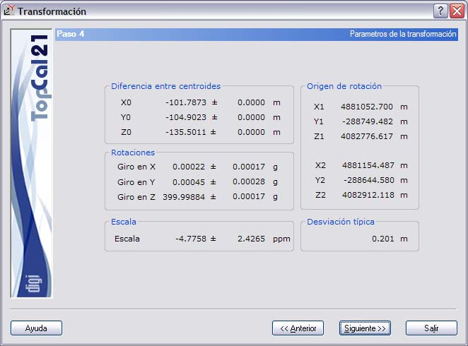

# Step 4: Transformation parameters
<!-- id: topcal21-transformacion-paso-4-parametros-de-la-transformacion -->
<!-- origen: db93cf19ac1b5de585af69d6e8a542b1a3c51e06 -->

This is the fourth step in computing the transformation.

A screen is shown with the transformation parameters, which vary depending on the type of transformation selected but, in general, are:

* **Translations** or **difference between centroids**
* **Origin of rotation**: Only if you chose to compute the transformation using centers of mass
* **Rotations**: Shown in grads
* **Scale factor**: Shown in parts per million
* **Standard deviation** of the transformation

If the selected transformation was Helmert 2D, the translations refer only to the XY coordinates, and only one rotation and one scale factor are shown.

If the selected transformation was Helmert 3D, the translations refer to the three XYZ coordinates, there is one rotation for each axis, and there is only one scale factor.

If the selected transformation was Affine 2D, the translations refer only to the XY coordinates, and the rotation and the scale factor are shown for each axis.

Each of the computed parameters is accompanied by the accuracy with which it was computed.

These parameters can be **saved to disk** in an ASCII file to apply them later to the points of another file. To use these parameters on another file, you can use the [Helmert/Affine coordinate transformation](../../calculos/transformacion-helmert-de-coordenadas/README.md) tool of the [Computations](../../menus-de-la-aplicacion/menu-calculos.md) menu.

Once you accept the data shown, click the **Next** button to go to [Step 5: Transformed points and output](paso-5-puntos-transformados-y-salida-de-datos.md), or click the **Back** button to return to [Step 3: Residuals](paso-3-puntos-transformados-y-residuos.md).
