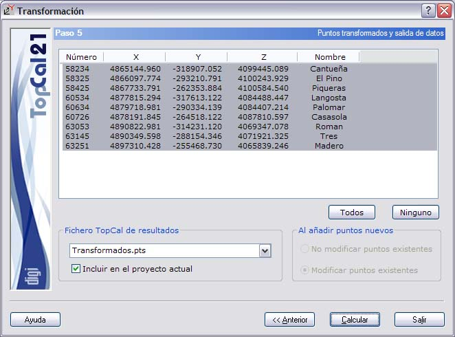

# Step 5: Transformed points and output
<!-- id: topcal21-transformacion-paso-5-puntos-transformados-y-salida-de-datos -->
<!-- origen: 6c71236e7e10f55a034dbdf6f8db14166d63e3de -->

This is the fifth and last step in computing the transformation.

The following fields are shown:

* **List of transformed non-common points**: The list shows the non-common points of system 2 with their computed coordinates in system 1. Select the points to save in the output file.
* **TopCal output file**: Select the name of the TopCal file where the points are stored. You can choose one of the existing files or generate a new one. If you want to generate a new file, you can choose whether or not to add the file to the current project.
* **Adding new points**: If the point file is not new, you can choose whether or not to modify the points with the same number that are in the chosen output file.

Once you have set up the output data, click the **Compute** button to finish the process, or click the **Back** button to return to the previous step, [Step 4: Transformation parameters](paso-4-parametros-de-la-transformacion.md).
