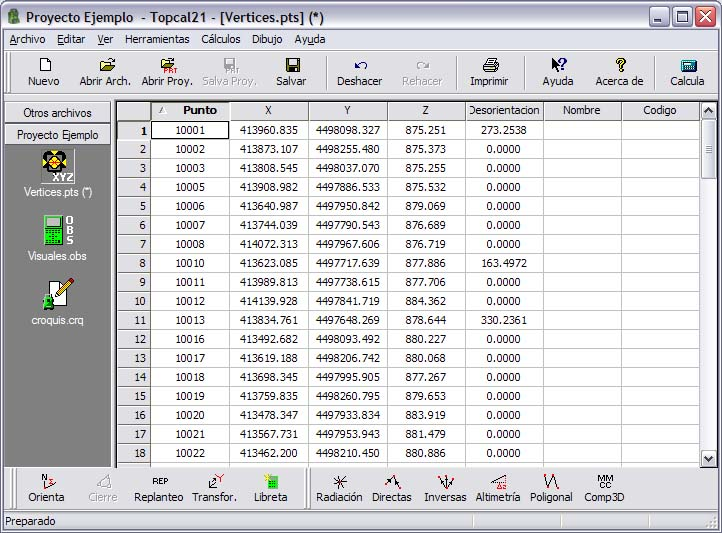
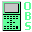

# User interface
<!-- id: topcal21-interfaz-de-usuario -->
<!-- origen: db387de2fdef6a99882b82515069b1cec7e14001 -->

The program shows a screen divided into two distinct parts: one on the left, which shows the open files and projects; and another on the right, which shows the contents of the files as a spreadsheet.

Toolbars at the top and bottom of the window contain the main program commands. You can move these toolbars.

The spreadsheet that shows the contents of the files allows the user to enter data manually. It also allows you to choose which data to display for each file and how to sort it. The data shown is different for each type of file. To enter data, just select the cell to modify with the keyboard cursor or the mouse and type the value directly. To modify an existing value, first press the *ENTER* key to start editing. To enter a value with decimals, the character that separates the decimal digits is the point. The units in which the values must be entered are stated in the definition of the file: they can be meters or feet for linear units, and grads, degrees or pseudodecimal degrees for angular units. To change the units of the current file, go to the file properties. For more information, see one of the following sections according to the type of file: [points](../opciones-de-visualizacion/propiedades-de-los-objetos/propiedades-del-archivo-de-puntos.md) or [observations](../opciones-de-visualizacion/propiedades-de-los-objetos/propiedades-del-archivo-de-visuales.md).

To enter angles in pseudodecimal format, enter the degrees, a decimal point, two digits for the minutes, two digits for the seconds, and the decimals of the seconds. For example, the angle 90 degrees 38 minutes 45.67 seconds is entered as 90.384567.

By default, point files are sorted in ascending order by *Point number* and observation files by *Station number* and by *Target number*. To sort the file by another field, click the header of that field; the data is first sorted in ascending order. If you click the same field again, the data is sorted in descending order.

You can also sort the data with the [Arrange data](../opciones-de-visualizacion/ordenar-datos.md) command of the [View](../menus-de-la-aplicacion/menu-ver.md) menu.

You can delete records by selecting the whole record and pressing the **Delete** key, or by right-clicking the record and selecting the **Delete record** command. TopCal 21 also considers a record as deleted if its identifier is zero. This means that there cannot be a point with a *Point number* equal to zero, nor any observation with a *Station number* or *Target number* equal to zero.

If a record is deleted, the program still shows it, but in red, if this option was enabled in the [Preferences](../opciones-de-visualizacion/preferencias.md) dialog box of the [Edit menu](../menus-de-la-aplicacion/menu-editar.md). You can also retrieve records by right-clicking the deleted record and selecting the **Retrieve record** command.

The program also allows you to select multiple records using the **CTRL** or **SHIFT** keys, or by pressing the left mouse button and, without releasing it, dragging a window over the records you want to select.

This way of presenting the data allows you to copy, cut and paste data between different windows or even between different programs. For this reason, you can select a set of records, cut them and paste them into Microsoft Excel to process them. You can also paste into TopCal 21 data cut or copied in Excel.

On the other hand, when a sketch file is active, the central view of the program looks like a drawing application and the toolbars related to editing drawing entities are enabled.

In this type of view, the user interacts with the displayed drawing elements with the computer mouse. When you move the mouse pointer within the document window, the application shows the coordinates of the pointer position in the status bar.

When a command requires selecting elements, make the selection with the left mouse button. The program then searches for entities around the current position of the mouse cursor.

If it finds an entity, the entity is highlighted in another color and the program asks you to confirm the selection to execute the command (by clicking the left mouse button again), to reject this selection to search for more entities in the same area (by clicking the right mouse button), or to end the search (by pressing the ESC key).

If the mouse has a center wheel, you can use it to zoom in or out of the current view.

The surveying data in TopCal 21 is structured as follows:

* [ Point files](../estructura-de-archivos/ficheros-de-puntos.md): These files store the coordinates of the points, their orientations and their names and codes, if they have any. Coordinate calculations use known point coordinates and field observations to compute the coordinates of other points.
* [ Observation files](../estructura-de-archivos/ficheros-de-visuales.md): These files store the observations made with surveying instruments. These observations are used to calculate the unknown coordinates of points. They consist of a station number and a target point number, a horizontal angle, a vertical angle, a distance, an instrument height, a reflector height and a code, if one was recorded.
* [Sketch or drawing files](../estructura-de-archivos/fichero-de-croquis.md): These files store geographic entities that were taken at the time the points were collected. In this way, points can be related with lines to represent linear elements, or symbols can be represented with singular points. This type of file is only generated within projects and depends on the point files it represents, and the program automatically updates the drawing geometry when the coordinates of points in those point files change.
* [ Project files](../estructura-de-archivos/fichero-de-proyecto.md): These files contain a list of the previous files that belong to the same job. Each project file creates a folder where the files are stored. Create one project for each job. With the project active, you can use the main tools of TopCal 21, such as traverse calculation, intersections, etc. In each project you can have as many point files, observation files or sketch files as you want.

TopCal 21 can have as many projects open as you want. It can also open point or observation files that are not in any particular project, and they are shown in a folder called **Other files**.

The tools included in TopCal 21 can be used depending on the type of file or project that is selected. Tools that need point files and observation files for the calculations require an active project. Other tools only need a point file or an observation file, so it is not necessary to create a project.

All the tools and utilities of TopCal 21 are distributed in the following menus:

* [File](../menus-de-la-aplicacion/menu-archivo.md): Contains all the commands for file operations and printing
* [Edit](../menus-de-la-aplicacion/menu-editar.md): Contains the commands for editing the spreadsheet data as well as the options for displaying that data. It also contains the tools for managing reference systems and surveying instruments
* [View](../menus-de-la-aplicacion/menu-ver.md): Contains the commands for displaying the toolbars, the file icons and the properties of the different objects
* [Tools](../menus-de-la-aplicacion/menu-herramientas.md): Contains the main surveying calculation tools of the program
* [Computations](../menus-de-la-aplicacion/menu-calculos.md): Contains the various geometric calculations that can be performed with the points, as well as operations with observations, coordinate transformations, etc.
* [Drawing](../menus-de-la-aplicacion/menu-dibujo.md): Contains the various commands for editing the sketch data
* [Help](../menus-de-la-aplicacion/menu-ayuda.md): Contains the commands related to help for using the application and its tools

The command bars contain the most commonly used commands for quick execution. The commands included in these bars show an icon that represents the function. Place the mouse pointer over an icon to see the name of the associated command. Click the icon to execute the command. The toolbars included are the following:

* [MainTool](../barras-de-herramientas/barra-de-herramientas-maintool.md): Contains the general commands of the program, such as opening, saving or printing files, or the help commands
* [TopcalTool](../barras-de-herramientas/barra-de-herramientas-topcaltool.md): Contains basic surveying calculation tools
* [Coordinates](../barras-de-herramientas/barra-de-herramientas-coordenadas.md): Contains the tools for calculating point coordinates in the various ways that surveying methods allow
* [Drawing](../barras-de-herramientas/barra-de-herramientas-dibujo.md): Includes tools for editing and managing the data contained in sketch files
* [Palette](../barras-de-herramientas/barra-de-herramientas-paleta.md): Contains tools for viewing or processing the entities of the current sketch file

The status bar shows information about the selected tool, as well as program prompts to the user. When a sketch file is active, it also shows the coordinates of the cursor.
