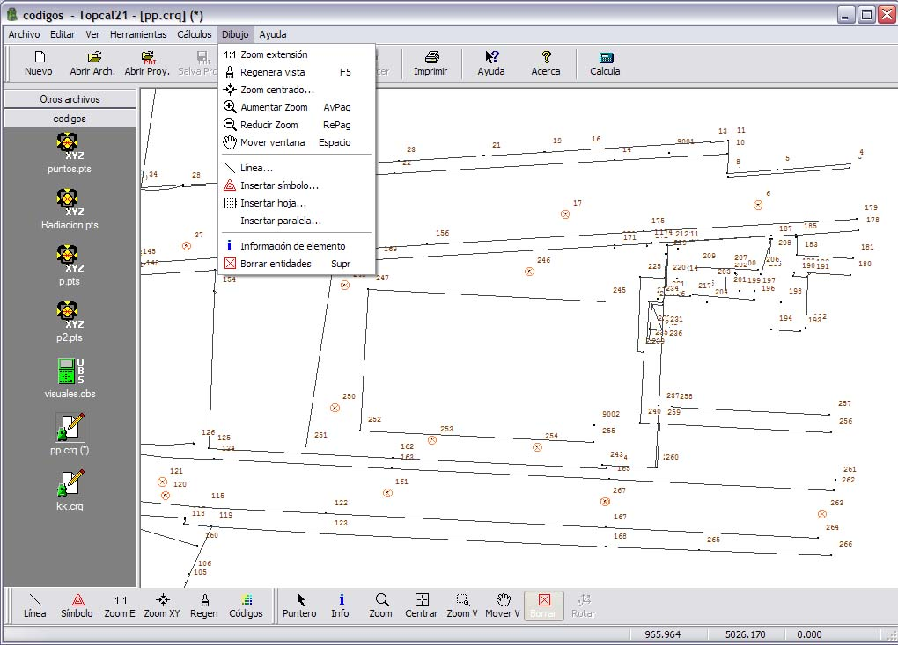
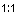
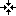
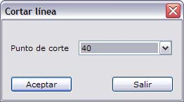

# Drawing menu
<!-- id: menu-dibujo -->
<!-- origen: 58fb03a283d1f697f88945892b4134ecf3b392b6 -->

This menu contains the various commands used to edit sketch data, such as:

*  **Fit window**: Adjusts the view to show the full extent of the current drawing document. This option is enabled only if a sketch file is active.
*  **Refresh View**: Redraws the sketch in the current view. This option is enabled only if a sketch file is active. This tool can be selected by pressing the \[F5\] key.
*  [Zoom Centered](../dibujo/centrar-pantalla-sobre-punto.md): Centers the current window on a given point or given coordinates. This option is enabled only if a sketch file is active.
* **Zoom In**: Enlarges the current view of the document. This tool can be selected by pressing the \[Page Down\] key.
* **Zoom Out**: Reduces the current view of the document. This tool can be selected by pressing the \[Page Up\] key.
* **Move Window**: With this option, the view can be moved in real time by pressing the left button without releasing it and moving the mouse. This tool can be selected by holding down the \[SPACE\] key.
*  **Add line**: When you select this tool, you can record geographic entities (lines or arcs) by graphically selecting on screen the points that define them. This option is enabled only if a sketch file is active. The procedure is as follows:
  * Click the left mouse button to select a point for a straight segment.
  * Hold **Shift** and click the left mouse button to select an arc point.
  * Press **Esc** to remove the last point from the entity being defined.
  * Click the right mouse button to open a [dialog box](../dibujo/dibuja-entidad.md) with the selected points and choose the layer for the entity.
*  **Add square**: When you select this tool, you can record linear entities in the shape of a square by graphically selecting on screen the points that define one of its diagonals. This option is enabled only if a sketch file is active. The procedure is as follows:
  * Click the left mouse button to select an endpoint of the square's diagonal.
  * Press **Esc** to remove the last point from the square being defined.
  * Click the right mouse button to open a [dialog box](../dibujo/insertar-cuadrado.md) with the selected points and choose the layer for the square.
*  **Add rectangle**: When you select this tool, you can record linear entities in the shape of a rectangle by graphically selecting on screen the points that define three of its corners. This option is enabled only if a sketch file is active. The procedure is as follows:
  * Click the left mouse button to select a corner of the rectangle.
  * Press **Esc** to remove the last point from the rectangle being defined.
  * Click the right mouse button to open a [dialog box](../dibujo/insertar-rectangulo.md) with the selected points and choose the layer for the rectangle.
*  [Add circle](../dibujo/insertar-circulo.md): Tool for recording an entity in the shape of a closed circle from various data: center, radius, points on the boundary, etc.
*  [Add symbol](../dibujo/insertar-simbolo.md): Displays a dialog box that lets you record point symbols at points belonging to the files related to the sketch. This option is enabled only if a sketch file is active.
*  [Add sheet](../dibujo/insertar-hoja.md): Displays a dialog box with which you can insert a reference sheet over the drawing, which can show coordinates in the margins and crosses inside it.
* [Add parallel](../dibujo/insertar-paralela.md): Tool for generating a parallel to a recorded entity.
* **Add by keyboard**: This submenu groups the drawing tools that can also be accessed through a dialog box where you can enter the points that define the shapes geometrically:
  *  [Line](../dibujo/dibuja-entidad.md): Displays a dialog box that lets you record geographic entities (lines or arcs) as a junction of the points of the files related to the sketch. This option is enabled only if a sketch file is active.
  *  [Square](../dibujo/insertar-cuadrado.md): Tool for recording a linear entity in the shape of a square from two points of a diagonal.
  *  [Rectangle](../dibujo/insertar-rectangulo.md): Tool for recording an entity in the shape of a quadrilateral from three of its corners.
* **Split line**: Tool for splitting a line at one of its vertex points, thus generating two different entities. Once you have chosen the line to split, the program displays a dialog box in which you must designate the split point. To designate the line you want to divide, select it with the left mouse button and accept the selection with the same button. If the desired entity was not selected, you can click the right mouse button so that the program continues searching for entities at the same location.

  
* **Join line**: Tool for joining two linear entities into one. To do so, both entities must belong to the same layer. The end points do not need to coincide. If they do not coincide, the program joins them with a new segment. To select the entities to join, click them with the left mouse button, accepting with the same button once the two desired entities have been selected. If the desired entities were not selected, you can click the right mouse button so that the program continues searching for entities at the same location.
* **Reading sketching codes**: Tool for rereading the information contained in the *Code* field of the point files linked to the current sketch. It is needed to re-create the automatic lines when a manual change is made to the *Code* field of the point file after the sketch was created. The sketch is updated automatically when the coordinates of the points change, but not when the change is made in the *Code* field, so you would need to run this tool.
* ** Element information**: Tool for displaying information about the selected element. Click the left button to select the desired element and click it again to confirm the selection. Click the right button to deselect it or to search for another element at the same location. You can also deselect it by pressing the \[ESC\] key.
* **Delete entities**: With this option, elements can be deleted from a drawing. This tool can be selected by pressing the \[DELETE\] key.
