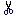
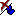
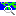
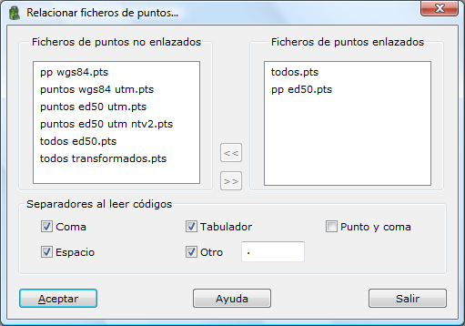

# Edit menu
<!-- id: menu-editar -->
<!-- origen: c795d3a1bed84556fa505d98b21d39ec7634bd9c -->

This menu brings together the commands for editing the data of the spreadsheet, as well as the options for displaying that data. It also contains the tools for managing reference systems and surveying instruments. The commands are:

* ** Undo**: Undoes the last operation. It is active only if a change has been made to the document. This tool can also be accessed with the key combination *Ctrl + Z*.
*  **Redo**: Redoes the last operation undone with the Undo command. It is active only if a previous operation has been undone. This tool can also be accessed with the key combination *Ctrl + Y*.
*  **Cut**: Cuts the currently selected data to the Windows clipboard, deleting it from the file. It is active only if some data is selected in the spreadsheet. This tool can also be accessed with the key combination *Ctrl + X*.
*  **Copy**: Copies the currently selected data to the Windows clipboard. It is active only if some data is selected in the spreadsheet. This tool can also be accessed with the key combination *Ctrl + C*.
*  **Paste**: Pastes the data from the Windows clipboard into the current file. It is active only if there is some data stored in the Windows clipboard. This tool can also be accessed with the key combination *Ctrl + V*.
* **Select All**: Selects all the data in the current spreadsheet. This tool can also be accessed with the key combination *Ctrl + E*.
* **Invert selection**: This command selects the records that are not currently selected. It is useful when it is easier to select what you do not want. For example, when you need to delete all the records except two, select those two and run this command; only the rest of the records become selected, and you can then delete them.
*  **Erase Register**: Puts a deletion mark on the current record or on the selected records. If the option to display these records is enabled, they are shown in red in the spreadsheet. To enable this option, see the [Preferences](../opciones-de-visualizacion/preferencias.md) dialog box.
*  **Retrieve Register**: Removes the deletion mark from the selected records.
* **Compact File**: Permanently removes from the file the records that have a deletion mark.
* [Renumber points](../otros-comandos/renumerar-puntos.md): Renumbers the points of the current file. It is active only if a point file is active.
* [Renumber observations](../otros-comandos/renumerar-visuales.md): Renumbers the observations of the current file. It is active only if an observation file is active.
* [Preferences](../opciones-de-visualizacion/preferencias.md): Shows the general options of the application.
* [Preferences of sketch](../opciones-de-visualizacion/preferencias-de-croquis.md): Shows the general drawing options of the application.
*  [Drawing Code List](../opciones-de-visualizacion/preferencias-de-dibujo/listado-de-codigos-de-dibujo.md): Shows the list of drawing codes.
*  [Sketching Code List](../opciones-de-visualizacion/preferencias-de-croquizacion/lista-de-codigos-de-croquizacion.md): Shows the list of automatic sketching codes.
*  [Symbols Library](../opciones-de-visualizacion/preferencias-de-simbolizacion/libreria-de-simbolos.md): Shows the list of symbols available to insert in the sketch.
*  [Reference Systems](../otros-comandos/sistemas-de-referencia/listado-de-sistemas-de-referencia.md): Shows a list of the reference systems stored in the application, which are used to create point files.
*  [Topographic Instruments](../otros-comandos/instrumentos-topograficos/listado-de-instrumentos-topograficos.md): Shows a list of the surveying instruments stored in the application, which are used to create observation files.
* **Link Point Files**: Links a [sketch file](../estructura-de-archivos/fichero-de-croquis.md) with the point files of the current project.

  
