# Tools menu
<!-- id: menu-herramientas -->
<!-- origen: eb9b9ec995a5d9c191d18e3f0350299674881223 -->

This menu contains the main surveying computation tools of the program. The tools are:

* 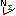 [Orientations](../herramientas/calculo-de-desorientaciones/README.md): Calculates the orientation of a point from observations to other points with known coordinates. This option is enabled only if a project is active.
* 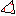 [Closure of triangles](../herramientas/cierre-de-triangulos/README.md): Calculates the closures of triangles formed by a set of observations taken between points. This option is enabled only if an observation file is active. Point files are not required.
* 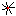 [COGO](../herramientas/radiacion/README.md): Calculates the coordinates of new points from the coordinates of a station and the corresponding angle and distance observations. This option is enabled only if a project is active.
* 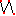 [Traverses](../herramientas/poligonales/README.md): Calculates the coordinates of new points from the chain of angle and distance observations taken between these points and at least one point with known coordinates. This option is enabled only if a project is active.
* [Alternate traverses](../herramientas/poligonales/README.md): This variant of the traverse computation calculates the coordinates of a set of stations in alternate traverses, in which the instrument is not set up at every point but alternately. Each leg has a single distance and a single height difference, so the program cannot check them against reciprocal values.
* 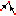 [Intersections](../herramientas/intersecciones-directas/README.md): Calculates the coordinates of new points from angle observations taken from at least two points with known coordinates. This option is enabled only if a project is active.
* 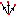 [3-point resections](../herramientas/intersecciones-inversas/README.md): Calculates the coordinates of new points from angle observations taken to at least three points with known coordinates. This option is enabled only if a project is active.
* 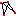 [Hansen's problem](../herramientas/intersecciones-de-hansen/README.md): Calculates the coordinates of two points from angle observations taken to two other points with known coordinates. This option is enabled only if a project is active.
* 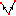 [2-point resections](../herramientas/biseccion-mixta/README.md): Calculates the coordinates of a point from the angle and distance observations taken from that point to two other points with known coordinates. This option is enabled only if a project is active.
* 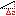 [Altimetry computation](../herramientas/compensacion-de-altimetria/README.md): Calculates the Z coordinate of a set of points from the observations taken in a height network, starting from at least one point with a known elevation. This option is enabled only if a project is active.
*  [Stakeout](../herramientas/replanteo/README.md): Generates a file with the angle and distance observations that must be taken to locate new points on the ground, in the stakeout operation. This option is enabled only if a project is active.
* 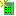 [Generate observations](../herramientas/generar-libreta-de-campo/README.md): Generates an observation file from the known coordinates of a set of points. This option is enabled only if a project is active.
* Observations sketches: Generates a sketch file with the observations taken from a station. This option is enabled only if a project is active.
* 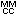 [Least Squares](../herramientas/compensacion-por-minimos-cuadrados/README.md): Adjusts, by the mathematical method of least squares, a network formed by a set of points between which angle and/or distance and/or height observations have been taken. This option is enabled only if a project is active. Before performing a horizontal adjustment, compute approximate XY coordinates for the non-fixed points. A vertical adjustment does not require approximate heights.
* 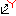 [Coordinates Transformation](../herramientas/transformacion/README.md): Transforms the coordinates of a point file to the coordinate system defined by the points of another file, using the points common to both systems. This option is enabled only if a project is active.
