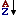

# View menu
<!-- id: menu-ver -->
<!-- origen: 35d5152c26c9a45cee97cc8f98fa2bc3aacdeaba -->

This menu contains the commands for displaying the toolbars, the file icons and the properties of the different objects. The commands are:

* [Toolbars](../opciones-de-visualizacion/ver-barras-de-herramientas.md): Shows a dialog box in which you can select the toolbars you want to display and their appearance.
* **Status Bar**: Enables or disables the status bar at the bottom of the application window, where the program messages to the user and the coordinates in sketch files are displayed.
*  [Arrange Data](../opciones-de-visualizacion/ordenar-datos.md): Shows a dialog box that lets you sort the current file by any of its fields.
* **Refresh**: Regenerates the current view, displaying the data again. This tool can also be accessed with the *F5* key.
* **Small Icons**: Shows the project elements with small icons.
* **Big Icons**: Shows the project elements with large icons.
* **Arrange Icons**: Arranges the elements of the current project by *name*, *type*, *size* or *date*. It also lets you arrange the elements automatically.
*  [Project Properties](../opciones-de-visualizacion/propiedades-de-los-objetos/propiedades-del-proyecto.md): Shows a dialog box with the properties of the current project.
*  **Object Properties**: Shows a dialog box with the properties of the current element, whether it is a [point](../opciones-de-visualizacion/propiedades-de-los-objetos/propiedades-del-archivo-de-puntos.md), [observation](../opciones-de-visualizacion/propiedades-de-los-objetos/propiedades-del-archivo-de-visuales.md) or [sketch](../opciones-de-visualizacion/propiedades-de-los-objetos/propiedades-del-archivo-de-croquis.md) file.
*  **Calculator**: Shows the system calculator, for performing simple computations.
